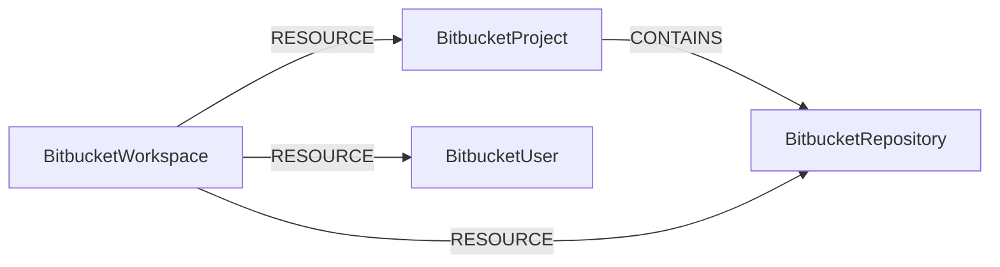

<!-- Generated from the data model. Do not edit manually. -->

## Bitbucket Schema

### BitbucketProject

A Bitbucket Cloud project, grouping repositories within a workspace.

#### Properties

| Field | Index | Description |
|-------|-------|-------------|
| id | Yes | Bitbucket project UUID. |
| firstseen |  | Timestamp when a sync job first created this node. |
| lastupdated | Yes | Timestamp of the last sync that observed this node. |
| created_on |  | Timestamp when Bitbucket created the project. |
| description |  | Human-readable description of the project. |
| is_private |  | Whether the project is private. |
| key | Yes | Short project key, unique within the workspace. |
| link_html |  | URL for viewing the project in Bitbucket. |
| name | Yes | Display name of the project. |
| updated_on |  | Timestamp of the project's most recent update. |

#### Relationships

- `(:BitbucketProject)-[:CONTAINS]->(:BitbucketRepository)`: Relationship from BitbucketRepository to BitbucketProject via CONTAINS.
Only created when a repository has a project assigned - repos with no
project simply omit the "project_id" key on their record.

- `(:BitbucketWorkspace)-[:RESOURCE]->(:BitbucketProject)`: Sub-resource relationship from BitbucketProject to BitbucketWorkspace, used for cleanup scoping.

### BitbucketRepository

A Bitbucket Cloud repository.

Every repository belongs to a workspace. Repositories also belong to a
project, except legacy repositories created before Bitbucket introduced
projects. Per-repository permissions, pull requests, and branch
restrictions aren't ingested.

> **Ontology Mapping**: This node uses the ontology label [`CodeRepository`](#ontology-coderepository).

#### Properties

| Field | Index | Description |
|-------|-------|-------------|
| id | Yes | Bitbucket repository UUID. |
| firstseen |  | Timestamp when a sync job first created this node. |
| lastupdated | Yes | Timestamp of the last sync that observed this node. |
| clone_https |  | HTTPS clone URL for the repository. |
| clone_ssh |  | SSH clone URL for the repository. |
| created_on |  | Timestamp when Bitbucket created the repository. |
| description |  | Human-readable description of the repository. |
| full_name | Yes | Repository full name, in the form workspace/repo_slug. |
| is_private |  | Whether the repository is private. |
| language |  | Primary programming language detected by Bitbucket. |
| link_html |  | URL for viewing the repository in Bitbucket. |
| mainbranch_name |  | Name of the repository's main branch. |
| name | Yes | Display name of the repository. |
| project_key |  | Key of the Bitbucket project this repository belongs to, if any. |
| scm |  | Source control system used by the repository, e.g. git. |
| size |  | Repository size in bytes. |
| slug | Yes | URL-friendly repository identifier. |
| updated_on |  | Timestamp of the repository's most recent update. |

#### Relationships

- `(:BitbucketProject)-[:CONTAINS]->(:BitbucketRepository)`: Relationship from BitbucketRepository to BitbucketProject via CONTAINS.
Only created when a repository has a project assigned - repos with no
project simply omit the "project_id" key on their record.

- `(:BitbucketWorkspace)-[:RESOURCE]->(:BitbucketRepository)`: Sub-resource relationship from BitbucketRepository to BitbucketWorkspace.
Repositories always belong to a workspace, even without a project, so the
workspace is the cleanup-scoping root.

### BitbucketUser

A current member of a Bitbucket Cloud workspace.

`id` is the Atlassian account ID, so a user who belongs to several synced
workspaces is one node with a `RESOURCE` relationship from each workspace.
Cartography doesn't map which users can access which repositories.

If Cartography can't list the members of any workspace in a run, it skips
`BitbucketUser` cleanup for every workspace in that run. Sync all of your
workspaces in a single run: when workspaces sync in separate runs, removing
a user from one workspace also removes the node and its other workspace
memberships until those workspaces sync again.

> **Ontology Mapping**: This node uses the ontology label [`UserAccount`](#ontology-useraccount).

#### Properties

| Field | Index | Description |
|-------|-------|-------------|
| id | Yes | Stable Atlassian account ID for the user. |
| firstseen |  | Timestamp when a sync job first created this node. |
| lastupdated | Yes | Timestamp of the last sync that observed this node. |
| avatar_url |  | URL of the user's avatar image. |
| display_name | Yes | Display name of the user. |
| link_html |  | URL for viewing the user's profile in Bitbucket. |
| nickname |  | Nickname of the user. |
| uuid | Yes | Bitbucket user UUID. |

#### Relationships

- `(:User)-[:HAS_ACCOUNT]->(:BitbucketUser)`: generated by analysis job `Ontology - UserAccount HAS_ACCOUNT User linking by normalized email`.

- `(:BitbucketWorkspace)-[:RESOURCE]->(:BitbucketUser)`: Sub-resource relationship from BitbucketUser to BitbucketWorkspace, used for cleanup scoping.

### BitbucketWorkspace

A Bitbucket Cloud workspace, the tenant boundary for projects, repositories,
and members.

Cartography syncs only the workspaces listed in `--bitbucket-workspaces`.
If you remove a workspace from that list, its node and children stay in
the graph.

> **Ontology Mapping**: This node uses the ontology label [`Tenant`](#ontology-tenant).

#### Properties

| Field | Index | Description |
|-------|-------|-------------|
| id | Yes | Bitbucket workspace UUID. |
| firstseen |  | Timestamp when a sync job first created this node. |
| lastupdated | Yes | Timestamp of the last sync that observed this node. |
| created_on |  | Timestamp when Bitbucket created the workspace. |
| is_private |  | Whether the workspace is private. |
| link_html |  | URL for viewing the workspace in Bitbucket. |
| name | Yes | Display name of the workspace. |
| slug | Yes | URL-friendly workspace identifier. |

#### Relationships

- `(:BitbucketWorkspace)-[:RESOURCE]->(:BitbucketProject)`: Sub-resource relationship from BitbucketProject to BitbucketWorkspace, used for cleanup scoping.

- `(:BitbucketWorkspace)-[:RESOURCE]->(:BitbucketRepository)`: Sub-resource relationship from BitbucketRepository to BitbucketWorkspace.
Repositories always belong to a workspace, even without a project, so the
workspace is the cleanup-scoping root.

- `(:BitbucketWorkspace)-[:RESOURCE]->(:BitbucketUser)`: Sub-resource relationship from BitbucketUser to BitbucketWorkspace, used for cleanup scoping.
