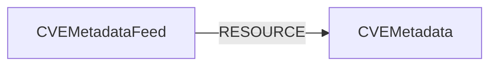

<!-- Generated from the data model. Do not edit manually. -->

## Cve Metadata Schema

### CVEMetadata

Enrichment metadata for a CVE, sourced from NVD, EPSS, the CISA KEV catalog,
and CISA Vulnrichment.

#### Properties

| Field | Index | Description |
|-------|-------|-------------|
| id | Yes | CVE identifier. |
| firstseen |  | Timestamp when a sync job first created this node. |
| lastupdated | Yes | Timestamp of the last sync that observed this node. |
| attack_complexity |  | CVSS attack complexity metric. |
| attack_vector |  | CVSS attack vector metric. |
| availability_impact |  | CVSS availability impact metric. |
| base_score |  | CVSS base score. |
| base_severity |  | CVSS base severity rating. |
| cisa_action_due |  | CISA KEV remediation due date, as copied into the NVD record. |
| cisa_exploit_add |  | Date when CISA added the CVE to the KEV catalog, as copied into the NVD record. |
| cisa_required_action |  | Remediation action required by CISA. |
| cisa_vulnerability_name |  | CISA vulnerability name. |
| confidentiality_impact |  | CVSS confidentiality impact metric. |
| cvss_version |  | CVSS version selected from the NVD metrics. |
| description |  | English description of the vulnerability. |
| effect_tags |  | Controlled technical effects derived from mapped CWEs when available, otherwise from high CVSS confidentiality, integrity, and availability impacts plus the network straight-shot rule. Values are execute-code, gain-privileges, access-credentials, bypass-control, disclose-data, tamper-data, and deny-service. |
| effect_tags_source |  | Derivation source for effect_tags: cwe takes strict precedence over the cvss fallback, and none indicates that no usable effects were found. |
| epss_percentile |  | EPSS percentile ranking from 0.0 to 1.0. |
| epss_score |  | EPSS probability of exploitation from 0.0 to 1.0. |
| exploitability_score |  | CVSS exploitability score. |
| impact_score |  | CVSS impact score. |
| integrity_impact |  | CVSS integrity impact metric. |
| is_kev | Yes | Whether the CVE appears in the CISA Known Exploited Vulnerabilities (KEV) catalog. Read from the catalog itself when the kev source is enabled and the catalog was fetched; otherwise from the KEV fields that NVD embeds in its records, which can lag the catalog. Unset when neither source has an answer. |
| is_kev_source |  | Where is_kev came from: kev for the CISA KEV catalog, nvd for the copy embedded in NVD records. Unset when is_kev is unset. |
| kev_date_added |  | Date (YYYY-MM-DD) CISA added the CVE to the KEV catalog. |
| kev_due_date |  | Remediation due date (YYYY-MM-DD) the KEV catalog sets for US federal civilian agencies. |
| kev_forensic_triage |  | KEV forensicTriage: true when the catalog entry calls for CISA's forensics triage requirements on affected systems in addition to remediation, false when it does not. |
| kev_ransomware_use |  | KEV knownRansomwareCampaignUse: Known when the CVE is known to be used in ransomware campaigns, otherwise Unknown. |
| last_modified_date |  | Date and time when the CVE was last modified. |
| privileges_required |  | CVSS privileges required metric. |
| problem_types |  | CWE identifiers associated with the vulnerability. |
| published_date |  | Date and time when the CVE was published. |
| references |  | Reference URLs for the vulnerability. |
| scope |  | CVSS scope metric. |
| ssvc_automatable |  | SSVC Automatable decision point: yes when an attacker can reliably automate steps 1 to 4 of the kill chain, otherwise no. |
| ssvc_exploitation |  | SSVC Exploitation decision point: none, poc (a public proof of concept exists), or active (evidence of exploitation in the wild). |
| ssvc_technical_impact |  | SSVC Technical Impact decision point: total when exploitation gives the attacker total control of the affected software or total disclosure of its information, otherwise partial. |
| ssvc_timestamp |  | When CISA made the SSVC decision. |
| ssvc_version |  | Version of the SSVC decision model used. |
| user_interaction |  | CVSS user interaction metric. |
| vector_string |  | CVSS vector string. |
| vuln_status |  | NVD vulnerability analysis status. |
| vulnrichment_updated_at |  | When the CVE record in CISA Vulnrichment was last updated. Set whenever Vulnrichment has a record for the CVE, even one without an SSVC decision. |

#### Relationships

- `(:CVEMetadata)-[:ENRICHES]->(:CVE)`: CVE metadata enriches its corresponding CVE.

- `(:CVEMetadataFeed)-[:RESOURCE]->(:CVEMetadata)`: A CVE metadata feed contains CVE metadata as a managed resource.

### CVEMetadataFeed

The enrichment feed used to manage CVE metadata lifecycle.

#### Properties

| Field | Index | Description |
|-------|-------|-------------|
| id | Yes | CVE metadata feed identifier. |
| firstseen |  | Timestamp when a sync job first created this node. |
| lastupdated | Yes | Timestamp of the last sync that observed this node. |
| kev_catalog_version |  | catalogVersion of the KEV catalog used by the sync. Unset when no catalog was used: the source was disabled, the fetch failed, or the catalog listed no CVEs or a number other than its count. |
| kev_date_released |  | dateReleased of the KEV catalog used by the sync. Unset when no catalog was used. |
| source_epss |  | Whether EPSS enrichment was enabled for the sync. |
| source_kev |  | Whether CISA KEV catalog enrichment was enabled for the sync. |
| source_nvd |  | Whether NVD enrichment was enabled for the sync. |
| source_vulnrichment |  | Whether CISA Vulnrichment enrichment was enabled for the sync. |
| vulnrichment_commit |  | Git commit of the Vulnrichment repository archive used by the sync, read from the archive's pax header. Unset when no archive was used (the source was disabled, or the archive could not be read in full or held no CVE records) or when it carried no commit. |

#### Relationships

- `(:CVEMetadataFeed)-[:RESOURCE]->(:CVEMetadata)`: A CVE metadata feed contains CVE metadata as a managed resource.
