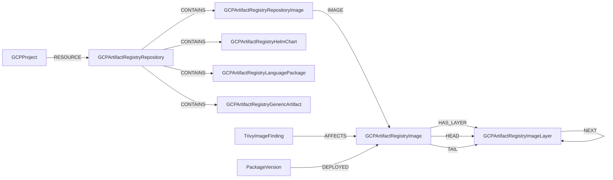

# Artifact Registry

Google Cloud Artifact Registry manages container images and language packages.
Cartography models repositories, repository-scoped image references,
digest-scoped images, image layers, Helm charts, language packages, and generic
artifacts.



Tagged DockerImage API records are expanded into one
`GCPArtifactRegistryRepositoryImage` node per tag. These nodes preserve the
repository-scoped, pullable image identity. Each repository-image node resolves
through `IMAGE` to digest-scoped `GCPArtifactRegistryImage` content, so multiple
tags, repositories, or projects may resolve to the same immutable image node.

Each sync writes only the tags and platform images that are new or changed
since the last sync. Unchanged ones, and the images the tags resolve to, get the
current update tag as `lastupdated`. Their `RESOURCE`, `CONTAINS`,
`REPO_IMAGE`, `IMAGE`, and `CONTAINS_IMAGE` relationships keep the
`lastupdated` of the sync that last wrote them. When the listing is complete, a
tag that it no longer returns is deleted with its relationships, and so is a
manifest list's `CONTAINS_IMAGE` relationship. When a repository cannot be
listed, for example because access is denied, no tag or `CONTAINS_IMAGE`
relationship is deleted. A tag that is written again always loses the
relationships it had before, such as the `IMAGE` relationship to the digest it
used to point to.

OCI image layers are modeled independently by uncompressed diff ID. `HAS_LAYER`
links an image to every layer, `HEAD` and `TAIL` mark the ordered boundaries,
and `NEXT` links adjacent layers.

## Trivy integration queries

Find all vulnerabilities affecting Artifact Registry container images:

```cypher
MATCH (vuln:TrivyImageFinding)-[:AFFECTS]->(img:GCPArtifactRegistryImage)<-[:IMAGE]-(repo_img:GCPArtifactRegistryRepositoryImage)
RETURN vuln.name, vuln.severity, repo_img.uri, img.digest
ORDER BY vuln.severity DESC
```

Find packages deployed in Artifact Registry images with their vulnerabilities:

```cypher
MATCH (pkg:PackageVersion)-[:DEPLOYED]->(img:GCPArtifactRegistryImage)<-[:IMAGE]-(repo_img:GCPArtifactRegistryRepositoryImage)
OPTIONAL MATCH (vuln:TrivyImageFinding)-[:AFFECTS]->(pkg)
RETURN repo_img.uri, pkg.name, pkg.version, collect(vuln.name) AS vulnerabilities
```

Find critical vulnerabilities in Artifact Registry images with available fixes:

```cypher
MATCH (vuln:TrivyImageFinding {severity: 'CRITICAL'})-[:AFFECTS]->(img:GCPArtifactRegistryImage)<-[:IMAGE]-(repo_img:GCPArtifactRegistryRepositoryImage)
MATCH (vuln)-[:AFFECTS]->(pkg:PackageVersion)
OPTIONAL MATCH (pkg)-[:SHOULD_UPDATE_TO]->(fix:TrivyFix)
RETURN vuln.name, repo_img.uri, pkg.name, pkg.version, fix.version AS fixed_version
```
