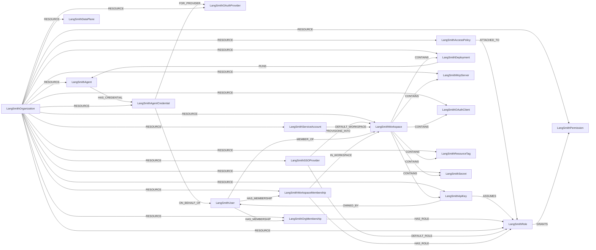

<!-- Generated from the data model. Do not edit manually. -->

## Langsmith Schema

### LangSmithAccessPolicy

An attribute-based access control policy. Policies attach to roles and restrict which
tagged resources the role's permissions apply to.

#### Properties

| Field | Index | Description |
|-------|-------|-------------|
| id | Yes | Access policy UUID. |
| firstseen |  | Timestamp when a sync job first created this node. |
| lastupdated | Yes | Timestamp of the last sync that observed this node. |
| condition_summary |  | Flattened, human-readable rendering of the policy's attribute-based condition groups, for example 'project.tag in [prod]'. |
| description |  | Human-readable description of the policy. |
| effect |  | Whether the policy allows or denies the matched resources. |
| name | Yes | Access policy name. |

#### Relationships

- `(:LangSmithAccessPolicy)-[:ATTACHED_TO]->(:LangSmithRole)`: An access policy narrows the resources a role applies to.

- `(:LangSmithOrganization)-[:RESOURCE]->(:LangSmithAccessPolicy)`: Links an organization to one of its access policies.

### LangSmithAgent

An agent (assistant) that can hold OAuth credentials.

Cartography discovers agents by listing each deployment's assistants on its own data
plane, because a LangGraph Platform agent id is an assistant id and the control plane
doesn't expose it. Deployments that declare an agent block, and credential records that name an
agent, top up the inventory.

#### Properties

| Field | Index | Description |
|-------|-------|-------------|
| id | Yes | Synthetic identifier of the form <organization_id>\|<assistant_id>. LangSmith derives an assistant id from its graph, so two organizations running the same graph can produce the same assistant id; namespacing keeps their agents, deployments and credential paths from merging. |
| firstseen |  | Timestamp when a sync job first created this node. |
| lastupdated | Yes | Timestamp of the last sync that observed this node. |
| assistant_id | Yes | The raw LangSmith assistant ID, as used by the agent-auth API. |
| created_at |  | Timestamp when the assistant was created. |
| description |  | Human-readable description of the agent. |
| environment |  | Environment the agent is deployed to, for example production. |
| graph_id |  | Identifier of the LangGraph graph this agent runs. |
| name |  | Agent name, taken from the deployment that serves it when one exists. |
| updated_at |  | Timestamp when the assistant was last updated. |
| version |  | Assistant version number. |

#### Relationships

- `(:LangSmithAgent)-[:HAS_CREDENTIAL]->(:LangSmithAgentCredential)`: The agent that can use this credential.

- `(:LangSmithOrganization)-[:RESOURCE]->(:LangSmithAgent)`: Links an organization to an agent running within it.

- `(:LangSmithDeployment)-[:RUNS]->(:LangSmithAgent)`: Links an agent to the deployment serving it.

Set when Cartography discovers the agent by listing the deployment's assistants, which
is the usual case. LangSmith fills a deployment's own agent block only for deployments
created with an explicit agent binding.

One-to-many: LangGraph derives an assistant id from its graph, so the same agent can be
served by several deployments.

### LangSmithAgentCredential

A third-party OAuth token a LangSmith agent holds on a human's behalf, letting the
agent call that provider's API as them.

Cartography ingests only metadata. oauth_token_id is an opaque reference, and
Cartography never requests or receives an access token, refresh token, or client secret.

#### Properties

| Field | Index | Description |
|-------|-------|-------------|
| id | Yes | Agent connection UUID. |
| firstseen |  | Timestamp when a sync job first created this node. |
| lastupdated | Yes | Timestamp of the last sync that observed this node. |
| created_at |  | Timestamp when the connection was authorized. |
| expires_at |  | Timestamp when the stored token expires, or null if it does not expire. |
| oauth_token_id |  | Identifier of the stored token record. This is an opaque reference only; no access or refresh token material is ingested. |
| provider_account_label |  | Label identifying which upstream account the token belongs to. |
| scopes |  | OAuth scopes the stored token was granted. |

#### Relationships

- `(:LangSmithAgentCredential)-[:FOR_PROVIDER]->(:LangSmithOAuthProvider)`: The third-party provider this credential authenticates against.

Matched on the provider's UUID, resolved during transform, rather than on its
provider_id slug. The slug is operator-chosen, so two organizations can both define
one called github-prod, and relationship matching carries no implicit organization
constraint.

- `(:LangSmithAgent)-[:HAS_CREDENTIAL]->(:LangSmithAgentCredential)`: The agent that can use this credential.

- `(:LangSmithAgentCredential)-[:ON_BEHALF_OF]->(:LangSmithUser)`: The human whose third-party account the agent can act as. This is the edge that answers
which agents hold which user's OAuth tokens.

- `(:LangSmithOrganization)-[:RESOURCE]->(:LangSmithAgentCredential)`: Links an organization to an agent credential held within it.

### LangSmithApiKey

A LangSmith credential: a personal access token, an organization service key, a
workspace API key, or a SCIM token. Cartography stores only the non-secret short prefix.

> **Ontology Mapping**: This node uses the ontology label [`APIKey`](#ontology-apikey).

#### Properties

Ontology-generated fields are shown in *italics*.

| Field | Index | Description |
|-------|-------|-------------|
| id | Yes | API key UUID. |
| firstseen |  | Timestamp when a sync job first created this node. |
| lastupdated | Yes | Timestamp of the last sync that observed this node. |
| access_scope |  | Whether the key is scoped to an organization or a workspace. |
| created_at |  | Timestamp when the key was created. |
| default_workspace_name |  | Name of the workspace this key targets when no workspace header is sent. |
| expires_at |  | Timestamp when the key expires, or null if the key never expires. |
| key_type | Yes | One of pat (personal access token, lsv2_pt), service_key (organization service key, lsv2_sk), workspace_key (workspace API key, lsv2_sk) or scim_token (lsv2_sc). |
| last_used_at |  | Timestamp when the key was last used to authenticate. |
| name |  | User-supplied description of the key. |
| read_only |  | Deprecated LangSmith flag retained on the API response. |
| revoked_at |  | Timestamp when the key was revoked, or null if the key is still live. |
| short_key |  | Truncated, non-secret prefix of the key, used to identify it in the UI. The full key value is never ingested. |
| workspace_names |  | Names of the workspaces this key can reach. |
| *_ont_created_at* | Yes | Normalized field sourced from `created_at`. |
| *_ont_expires_at* | Yes | Normalized field sourced from `expires_at`. |
| *_ont_last_used_at* | Yes | Normalized field sourced from `last_used_at`. |
| *_ont_name* | Yes | Normalized field sourced from `name`. |
| *_ont_source* |  | Module that populated this node's ontology fields. |

#### Relationships

- `(:LangSmithApiKey)-[:ASSUMES]->(:LangSmithRole)`: An API key acts with the permissions of the roles it is bound to.

- `(:LangSmithWorkspace)-[:CONTAINS]->(:LangSmithApiKey)`: A workspace-scoped API key belongs to a workspace.

- `(:LangSmithApiKey)-[:OWNED_BY]->(:LangSmithUser)`: An API key is owned by the user account that created it.

- `(:User)-[:OWNS]->(:LangSmithApiKey)`: generated by analysis job `Ontology - User OWNS APIKey linking`.

- `(:LangSmithOrganization)-[:RESOURCE]->(:LangSmithApiKey)`: Links an organization to an API key issued within it.

### LangSmithDataPlane

A self-hosted or bring-your-own-cloud data plane serving LangSmith workspaces.

#### Properties

| Field | Index | Description |
|-------|-------|-------------|
| id | Yes | Data plane UUID. |
| firstseen |  | Timestamp when a sync job first created this node. |
| lastupdated | Yes | Timestamp of the last sync that observed this node. |
| created_at |  | Timestamp when the data plane was registered. |
| name | Yes | Data plane name. |
| status |  | Data plane status. |
| url |  | URL of the data plane. |

#### Relationships

- `(:LangSmithOrganization)-[:RESOURCE]->(:LangSmithDataPlane)`: Links an organization to a data plane registered to it.

### LangSmithDeployment

A LangGraph Platform deployment serving an agent.

#### Properties

| Field | Index | Description |
|-------|-------|-------------|
| id | Yes | Deployment UUID. |
| firstseen |  | Timestamp when a sync job first created this node. |
| lastupdated | Yes | Timestamp of the last sync that observed this node. |
| created_at |  | Timestamp when the deployment was created. |
| display_name |  | Human-readable deployment name. |
| image_version |  | Image version currently deployed. |
| is_managed_deep_agent |  | True if this is a Managed Deep Agent deployment. |
| is_preview |  | True if this is a preview-build deployment. |
| name | Yes | Deployment name. |
| route_through_gateway |  | True if OpenAI and Anthropic model calls are routed through the LangSmith LLM gateway. |
| secret_names |  | Names of the environment secrets configured on the deployment. Secret values are discarded during transform and are never written to the graph. |
| secret_reference_names |  | Names of the Kubernetes Secret references configured on the deployment. |
| shareable |  | True if the deployment can be shared with LangSmith users outside the organization. |
| source |  | Where the deployment image comes from, for example github or external_docker. |
| status |  | Deployment status. |
| tracer_session_id |  | UUID of the LangSmith tracing project the deployment writes runs to. |
| updated_at |  | Timestamp when the deployment was last updated. |
| url |  | Serving URL of the deployment, once provisioned. |

#### Relationships

- `(:LangSmithWorkspace)-[:CONTAINS]->(:LangSmithDeployment)`: Links a deployment to the workspace that owns it.

- `(:LangSmithOrganization)-[:RESOURCE]->(:LangSmithDeployment)`: Links an organization to a deployment running within it.

- `(:LangSmithDeployment)-[:RUNS]->(:LangSmithAgent)`: Links an agent to the deployment serving it.

Set when Cartography discovers the agent by listing the deployment's assistants, which
is the usual case. LangSmith fills a deployment's own agent block only for deployments
created with an explicit agent binding.

One-to-many: LangGraph derives an assistant id from its graph, so the same agent can be
served by several deployments.

### LangSmithMcpServer

An MCP server a LangSmith workspace exposes to its agents.

#### Properties

| Field | Index | Description |
|-------|-------|-------------|
| id | Yes | MCP server or gateway UUID. |
| firstseen |  | Timestamp when a sync job first created this node. |
| lastupdated | Yes | Timestamp of the last sync that observed this node. |
| auth_type |  | How callers authenticate to this MCP server, for example oauth or none. |
| created_at |  | Timestamp when the MCP server was registered. |
| description |  | Human-readable description of the MCP server. |
| name | Yes | MCP server name. |
| slug |  | MCP server slug. |
| status |  | MCP server status. |
| tool_names |  | Names of the tools this MCP server exposes, where the API reports them. |
| updated_at |  | Timestamp when the MCP server was last updated. |
| url |  | URL the MCP server is served from. |
| vendor |  | MCP vendor fronting this server, when it is a vendor-managed gateway. |

#### Relationships

- `(:LangSmithWorkspace)-[:CONTAINS]->(:LangSmithMcpServer)`: Links an MCP server to the workspace that exposes it.

- `(:LangSmithOrganization)-[:RESOURCE]->(:LangSmithMcpServer)`: Links an organization to an MCP server registered within it.

### LangSmithOAuthClient

A third-party application registered to call the LangSmith API through OAuth. This is
LangSmith acting as the authorization server, the reverse direction from
LangSmithOAuthProvider.

> **Ontology Mapping**: This node uses the ontology label [`ThirdPartyApp`](#ontology-thirdpartyapp).

#### Properties

Ontology-generated fields are shown in *italics*.

| Field | Index | Description |
|-------|-------|-------------|
| id | Yes | OAuth client ID issued by LangSmith. |
| firstseen |  | Timestamp when a sync job first created this node. |
| lastupdated | Yes | Timestamp of the last sync that observed this node. |
| allowed_scopes |  | LangSmith scopes this client is permitted to request. |
| client_type |  | Client type, for example public or confidential. |
| client_uri |  | Home page URI of the client application. |
| created_at |  | Timestamp when the client was registered. |
| disabled |  | True if the client has been disabled. |
| grant_types |  | OAuth grant types this client may use. |
| logo_uri |  | Logo URI of the client application. |
| name | Yes | Display name of the OAuth client. |
| policy_uri |  | Privacy policy URI of the client application. |
| redirect_uris |  | Redirect URIs registered for this client. |
| tos_uri |  | Terms of service URI of the client application. |
| updated_at |  | Timestamp when the client was last updated. |
| *_ont_client_id* | Yes | Normalized field sourced from `id`. |
| *_ont_name* | Yes | Normalized field sourced from `name`. |
| *_ont_source* |  | Module that populated this node's ontology fields. |

#### Relationships

- `(:User)-[:AUTHORIZED]->(:LangSmithOAuthClient)`: generated by analysis job `Ontology - User AUTHORIZED ThirdPartyApp linking`.
  - Properties:

    | Field | Description |
    |-------|-------------|
    | scopes | Property generated by analysis job: `Ontology - User AUTHORIZED ThirdPartyApp linking`. |

- `(:LangSmithWorkspace)-[:CONTAINS]->(:LangSmithOAuthClient)`: Links an OAuth client to the workspace it was registered in.

- `(:LangSmithOrganization)-[:RESOURCE]->(:LangSmithOAuthClient)`: Links an organization to an OAuth client registered against it.

### LangSmithOAuthProvider

A third-party OAuth provider that LangSmith agents can obtain tokens from on a user's
behalf, such as GitHub, Google or an MCP server.

> **Ontology Mapping**: This node uses the ontology label [`ThirdPartyApp`](#ontology-thirdpartyapp).

#### Properties

Ontology-generated fields are shown in *italics*.

| Field | Index | Description |
|-------|-------|-------------|
| id | Yes | OAuth provider record UUID. |
| firstseen |  | Timestamp when a sync job first created this node. |
| lastupdated | Yes | Timestamp of the last sync that observed this node. |
| allowed_redirect_uris |  | Redirect URIs accepted when completing the OAuth flow. |
| auth_url |  | Upstream authorization endpoint. |
| client_id |  | OAuth client ID registered with the upstream provider. The client secret is never returned by the API and is not ingested. |
| created_at |  | Timestamp when the provider was registered. |
| is_dynamic_client |  | True if the OAuth client was registered dynamically rather than configured. |
| is_platform_provider |  | True if this is a LangChain-managed provider rather than one the organization configured. |
| mcp_server_url |  | URL of the MCP server this provider fronts, when the provider is MCP-backed. |
| name |  | Display name of the OAuth provider. |
| provider_id | Yes | Operator-chosen provider slug, for example github-prod. |
| provider_type |  | Provider category, for example oauth2 or mcp. |
| token_endpoint_auth_method |  | How LangSmith authenticates to the token endpoint. |
| token_url |  | Upstream token endpoint. |
| updated_at |  | Timestamp when the provider was last updated. |
| uses_pkce |  | True if the provider uses PKCE. |
| *_ont_client_id* | Yes | Normalized field sourced from `client_id`. |
| *_ont_name* | Yes | Normalized field sourced from `name`. |
| *_ont_source* |  | Module that populated this node's ontology fields. |

#### Relationships

- `(:User)-[:AUTHORIZED]->(:LangSmithOAuthProvider)`: generated by analysis job `Ontology - User AUTHORIZED ThirdPartyApp linking`.
  - Properties:

    | Field | Description |
    |-------|-------------|
    | scopes | Property generated by analysis job: `Ontology - User AUTHORIZED ThirdPartyApp linking`. |

- `(:LangSmithAgentCredential)-[:FOR_PROVIDER]->(:LangSmithOAuthProvider)`: The third-party provider this credential authenticates against.

Matched on the provider's UUID, resolved during transform, rather than on its
provider_id slug. The slug is operator-chosen, so two organizations can both define
one called github-prod, and relationship matching carries no implicit organization
constraint.

- `(:LangSmithOrganization)-[:RESOURCE]->(:LangSmithOAuthProvider)`: Links an organization to an OAuth provider configured within it.

### LangSmithOrganization

A LangSmith organization: the top-level tenant that owns workspaces, users and roles.

> **Ontology Mapping**: This node uses the ontology label [`Tenant`](#ontology-tenant).

#### Properties

Ontology-generated fields are shown in *italics*.

| Field | Index | Description |
|-------|-------|-------------|
| id | Yes | LangSmith organization UUID. |
| firstseen |  | Timestamp when a sync job first created this node. |
| lastupdated | Yes | Timestamp of the last sync that observed this node. |
| disabled |  | True if the organization is disabled. |
| invites_enabled |  | True if members may be invited to the organization. |
| ip_allowlist_enabled |  | True if an IP allowlist is enforced for this organization. |
| is_personal |  | True if this is a personal organization rather than a shared one. |
| jit_provisioning_enabled |  | True if SSO just-in-time user provisioning is enabled. |
| max_api_key_expiry_days |  | Maximum lifetime in days allowed for an API key, or null for unlimited. |
| max_pat_expiry_days |  | Maximum lifetime in days allowed for a personal access token, or null for unlimited. |
| max_service_key_expiry_days |  | Maximum lifetime in days allowed for a service key, or null for unlimited. |
| name |  | Organization display name. |
| pat_creation_disabled |  | True if members are blocked from creating personal access tokens. |
| public_sharing_disabled |  | True if publicly sharing runs, prompts and datasets is blocked. |
| security_contact |  | Email address listed as the organization's security contact. |
| sso_login_slug |  | Vanity slug used for the SSO login URL. |
| sso_only |  | True if members may only authenticate through SSO. |
| tier |  | Payment plan tier the organization is on. |
| workspace_admin_can_invite_to_org |  | True if workspace admins may invite users to the whole organization. |
| *_ont_name* | Yes | Normalized field sourced from `name`. |
| *_ont_source* |  | Module that populated this node's ontology fields. |

#### Relationships

- `(:LangSmithOrganization)-[:RESOURCE]->(:LangSmithAccessPolicy)`: Links an organization to one of its access policies.

- `(:LangSmithOrganization)-[:RESOURCE]->(:LangSmithAgent)`: Links an organization to an agent running within it.

- `(:LangSmithOrganization)-[:RESOURCE]->(:LangSmithAgentCredential)`: Links an organization to an agent credential held within it.

- `(:LangSmithOrganization)-[:RESOURCE]->(:LangSmithApiKey)`: Links an organization to an API key issued within it.

- `(:LangSmithOrganization)-[:RESOURCE]->(:LangSmithDataPlane)`: Links an organization to a data plane registered to it.

- `(:LangSmithOrganization)-[:RESOURCE]->(:LangSmithDeployment)`: Links an organization to a deployment running within it.

- `(:LangSmithOrganization)-[:RESOURCE]->(:LangSmithMcpServer)`: Links an organization to an MCP server registered within it.

- `(:LangSmithOrganization)-[:RESOURCE]->(:LangSmithOAuthClient)`: Links an organization to an OAuth client registered against it.

- `(:LangSmithOrganization)-[:RESOURCE]->(:LangSmithOAuthProvider)`: Links an organization to an OAuth provider configured within it.

- `(:LangSmithOrganization)-[:RESOURCE]->(:LangSmithOrgMembership)`: Links an organization to one of its memberships.

- `(:LangSmithOrganization)-[:RESOURCE]->(:LangSmithPermission)`: Links an organization to a permission available within it.

- `(:LangSmithOrganization)-[:RESOURCE]->(:LangSmithResourceTag)`: Links an organization to a resource tag defined within it.

- `(:LangSmithOrganization)-[:RESOURCE]->(:LangSmithRole)`: Links an organization to a role available within it.

- `(:LangSmithOrganization)-[:RESOURCE]->(:LangSmithSSOProvider)`: Links an organization to its configured SSO provider.

- `(:LangSmithOrganization)-[:RESOURCE]->(:LangSmithSecret)`: Links an organization to a workspace secret held within it.

- `(:LangSmithOrganization)-[:RESOURCE]->(:LangSmithServiceAccount)`: Links an organization to one of its service accounts.

- `(:LangSmithOrganization)-[:RESOURCE]->(:LangSmithWorkspace)`: Links an organization to a workspace it owns.

- `(:LangSmithOrganization)-[:RESOURCE]->(:LangSmithWorkspaceMembership)`: Links an organization to a workspace membership within it.

### LangSmithOrgMembership

A user's membership in a single organization, together with the role they hold there.

Modeled as a node so that organization-specific state stays organization-specific: a
user can belong to several organizations, and each has its own view of whether that
identity is disabled, what role it holds and how it was provisioned.

#### Properties

| Field | Index | Description |
|-------|-------|-------------|
| id | Yes | Synthetic identifier of the form <organization_id>\|<ls_user_id>. |
| firstseen |  | Timestamp when a sync job first created this node. |
| lastupdated | Yes | Timestamp of the last sync that observed this node. |
| created_at |  | Timestamp when the user joined the organization. |
| email |  | Email address of the member, denormalized for convenience. |
| identity_id |  | UUID of the organization-scoped identity row backing this membership. This is a membership identifier, not a user identifier. |
| is_disabled |  | True if this organization identity is deactivated. Deactivated identities cannot authenticate, and their personal access tokens are rejected. This is per-organization state, which is why it is not on the user node. |
| is_pending |  | True if this is an outstanding invitation rather than an accepted membership. |
| login_methods |  | Auth providers linked to this identity, for example email, oidc or saml. |
| ls_user_id | Yes | Stable LangSmith user ID of the member. |
| provisioning_methods |  | How the identity's login methods were provisioned, for example scim or saml:jit. |
| role_name |  | Display name of the organization role held. |

#### Relationships

- `(:LangSmithUser)-[:HAS_MEMBERSHIP]->(:LangSmithOrgMembership)`: Links a user to their membership of one organization.

- `(:LangSmithOrgMembership)-[:HAS_ROLE]->(:LangSmithRole)`: Links a membership to the organization role it confers.

- `(:LangSmithOrganization)-[:RESOURCE]->(:LangSmithOrgMembership)`: Links an organization to one of its memberships.

### LangSmithPermission

A single LangSmith permission string that roles may grant.

#### Properties

| Field | Index | Description |
|-------|-------|-------------|
| id | Yes | Synthetic identifier of the form <organization_id>\|<permission string>. Permission strings repeat across organizations, and each organization's cleanup must only ever touch its own nodes. |
| firstseen |  | Timestamp when a sync job first created this node. |
| lastupdated | Yes | Timestamp of the last sync that observed this node. |
| access_scope |  | Whether the permission applies at organization or workspace scope. |
| name | Yes | Permission string, for example organization:manage or deployments:read. |

#### Relationships

- `(:LangSmithRole)-[:GRANTS]->(:LangSmithPermission)`: A role grants a permission.

- `(:LangSmithOrganization)-[:RESOURCE]->(:LangSmithPermission)`: Links an organization to a permission available within it.

### LangSmithResourceTag

A workspace resource tag. Tags are the attributes that attribute-based access policies
match on.

Cartography doesn't ingest the tagging edges that attach these tags to individual
projects, datasets, and prompts, because those resource types are outside this module's
scope.

> **Ontology Mapping**: This node uses the ontology label [`Tag`](#ontology-tag).

#### Properties

Ontology-generated fields are shown in *italics*.

| Field | Index | Description |
|-------|-------|-------------|
| id | Yes | Tag value UUID. |
| firstseen |  | Timestamp when a sync job first created this node. |
| lastupdated | Yes | Timestamp of the last sync that observed this node. |
| key | Yes | Tag key name. |
| key_id |  | UUID of the tag key this value belongs to. |
| value |  | Tag value. |
| workspace_id |  | UUID of the workspace the tag is defined in. |
| *_ont_source* |  | Module that populated this node's ontology fields. |

#### Relationships

- `(:LangSmithWorkspace)-[:CONTAINS]->(:LangSmithResourceTag)`: Links a resource tag to the workspace it is defined in.

- `(:LangSmithOrganization)-[:RESOURCE]->(:LangSmithResourceTag)`: Links an organization to a resource tag defined within it.

### LangSmithRole

A LangSmith RBAC role, either a built-in system role or an organization's custom role.

> **Ontology Mapping**: This node uses the ontology label [`PermissionRole`](#ontology-permissionrole).

#### Properties

Ontology-generated fields are shown in *italics*.

| Field | Index | Description |
|-------|-------|-------------|
| id | Yes | Synthetic identifier of the form <organization_id>\|<role UUID>. Built-in roles keep the same UUID in every organization. |
| firstseen |  | Timestamp when a sync job first created this node. |
| lastupdated | Yes | Timestamp of the last sync that observed this node. |
| access_scope |  | Whether the role applies at organization or workspace scope. |
| description |  | Human-readable description of the role. |
| is_custom |  | True if this is a user-defined role rather than a LangSmith built-in. Derived from the presence of an owning organization_id. |
| is_restricted |  | True if the organization has applied a restriction to this role. |
| name | Yes | Role display name. Prefer this over system_name: every custom role is stored with the system name CUSTOM, so only the display name distinguishes them. |
| role_id | Yes | LangSmith role UUID. |
| role_type |  | builtin for a LangSmith system role, custom for an organization-defined one. |
| system_name |  | Internal role name, for example ORGANIZATION_ADMIN or WORKSPACE_VIEWER. Always CUSTOM for user-defined roles. |
| *_ont_name* | Yes | Normalized field sourced from `name`. |
| *_ont_scope* | Yes | Normalized field sourced from `access_scope`. |
| *_ont_source* |  | Module that populated this node's ontology fields. |
| *_ont_type* | Yes | Normalized field sourced from `role_type`. |

#### Relationships

- `(:LangSmithApiKey)-[:ASSUMES]->(:LangSmithRole)`: An API key acts with the permissions of the roles it is bound to.

- `(:LangSmithAccessPolicy)-[:ATTACHED_TO]->(:LangSmithRole)`: An access policy narrows the resources a role applies to.

- `(:LangSmithSSOProvider)-[:DEFAULT_ROLE]->(:LangSmithRole)`: The workspace role granted to users provisioned through this provider.

- `(:LangSmithRole)-[:GRANTS]->(:LangSmithPermission)`: A role grants a permission.

- `(:LangSmithOrgMembership)-[:HAS_ROLE]->(:LangSmithRole)`: Links a membership to the organization role it confers.

- `(:LangSmithWorkspaceMembership)-[:HAS_ROLE]->(:LangSmithRole)`: Links a membership to the role it confers in that workspace.

- `(:LangSmithOrganization)-[:RESOURCE]->(:LangSmithRole)`: Links an organization to a role available within it.

### LangSmithSecret

A workspace secret. Cartography ingests only the key name and never calls LangSmith's
encrypted-secrets endpoint.

> **Ontology Mapping**: This node uses the ontology label [`Secret`](#ontology-secret).

#### Properties

Ontology-generated fields are shown in *italics*.

| Field | Index | Description |
|-------|-------|-------------|
| id | Yes | Synthetic identifier of the form <workspace_id>\|<key>. |
| firstseen |  | Timestamp when a sync job first created this node. |
| lastupdated | Yes | Timestamp of the last sync that observed this node. |
| name | Yes | Secret key name. The secret value is never ingested. |
| workspace_id |  | UUID of the workspace holding the secret. |
| *_ont_name* | Yes | Normalized field sourced from `name`. |
| *_ont_source* |  | Module that populated this node's ontology fields. |

#### Relationships

- `(:LangSmithWorkspace)-[:CONTAINS]->(:LangSmithSecret)`: Links a secret to the workspace that holds it.

- `(:LangSmithOrganization)-[:RESOURCE]->(:LangSmithSecret)`: Links an organization to a workspace secret held within it.

### LangSmithServiceAccount

A LangSmith service account: a non-human principal that can hold service keys.

> **Ontology Mapping**: This node uses the ontology label [`ServiceAccount`](#ontology-serviceaccount).

#### Properties

Ontology-generated fields are shown in *italics*.

| Field | Index | Description |
|-------|-------|-------------|
| id | Yes | Service account UUID. |
| firstseen |  | Timestamp when a sync job first created this node. |
| lastupdated | Yes | Timestamp of the last sync that observed this node. |
| created_at |  | Timestamp when the service account was created. |
| name | Yes | Service account name. |
| updated_at |  | Timestamp when the service account was last updated. |
| *_ont_name* | Yes | Normalized field sourced from `name`. |
| *_ont_source* |  | Module that populated this node's ontology fields. |

#### Relationships

- `(:LangSmithServiceAccount)-[:DEFAULT_WORKSPACE]->(:LangSmithWorkspace)`: Links a service account to the workspace it defaults to.

- `(:LangSmithOrganization)-[:RESOURCE]->(:LangSmithServiceAccount)`: Links an organization to one of its service accounts.

### LangSmithSSOProvider

An SSO identity provider configured for a LangSmith organization.

> **Ontology Mapping**: This node uses the ontology label [`IdentityProvider`](#ontology-identityprovider).

#### Properties

Ontology-generated fields are shown in *italics*.

| Field | Index | Description |
|-------|-------|-------------|
| id | Yes | SSO settings UUID. |
| firstseen |  | Timestamp when a sync job first created this node. |
| lastupdated | Yes | Timestamp of the last sync that observed this node. |
| attribute_mapping_load_error |  | Error reported while loading the provider's attribute mapping, if any. |
| has_metadata_xml |  | True if SSO metadata was supplied inline as XML rather than by URL. The XML itself is not ingested. |
| metadata_url |  | URL of the provider's SAML or OIDC metadata document. |
| name | Yes | Identifier of the upstream SSO provider. |
| sso_groups_claim_field |  | Name of the assertion claim carrying the user's groups. |
| sso_groups_enabled |  | True if group claims from the provider are consumed. |
| sso_groups_required |  | True if a user must carry a matching group claim in order to log in. |
| sso_groups_role_sync_enabled |  | True if workspace roles are synchronized from provider group claims. |
| *_ont_name* | Yes | Normalized field sourced from `name`. |
| *_ont_source* |  | Module that populated this node's ontology fields. |

#### Relationships

- `(:LangSmithSSOProvider)-[:DEFAULT_ROLE]->(:LangSmithRole)`: The workspace role granted to users provisioned through this provider.

- `(:LangSmithSSOProvider)-[:PROVISIONS_INTO]->(:LangSmithWorkspace)`: A workspace that just-in-time provisioned users are placed into by default.

- `(:LangSmithOrganization)-[:RESOURCE]->(:LangSmithSSOProvider)`: Links an organization to its configured SSO provider.

### LangSmithUser

A LangSmith user account, keyed on the stable ls_user_id.

A user can belong to several organizations, so this node deliberately carries only
identity that is true of the person everywhere. Everything organization-specific, such as
whether the identity is disabled, which organization role it holds, and how it was
provisioned, lives on LangSmithOrgMembership, because storing it here would mean one
organization's sync overwriting another's view of the same human.

For the same reason the node has no sub-resource relationship: it is not owned by any
single organization, and cleanup never deletes it, so one organization's sync cannot
destroy an identity another organization still references. Its relationships are all
owned by organization-scoped schemas (memberships, keys, credentials) or by the
organization-scoped MEMBER_OF matchlink, and cleanup prunes them with their owner.

> **Ontology Mapping**: This node uses the ontology label [`UserAccount`](#ontology-useraccount).

#### Properties

Ontology-generated fields are shown in *italics*.

| Field | Index | Description |
|-------|-------|-------------|
| id | Yes | Stable LangSmith user ID. Used instead of the user_id field, which mirrors the first linked auth provider subject and is not stable across login methods. |
| firstseen |  | Timestamp when a sync job first created this node. |
| lastupdated | Yes | Timestamp of the last sync that observed this node. |
| avatar_url |  | URL of the user's avatar image. |
| display_name |  | User display name. |
| email | Yes | User email address. |
| ls_user_id |  | Stable LangSmith user ID. |
| name |  | User full name. |
| *_ont_email* | Yes | Normalized field sourced from `email`. |
| *_ont_fullname* | Yes | Normalized field sourced from `name`. |
| *_ont_source* |  | Module that populated this node's ontology fields. |

#### Relationships

- `(:User)-[:HAS_ACCOUNT]->(:LangSmithUser)`

- `(:LangSmithUser)-[:HAS_MEMBERSHIP]->(:LangSmithOrgMembership)`: Links a user to their membership of one organization.

- `(:LangSmithUser)-[:HAS_MEMBERSHIP]->(:LangSmithWorkspaceMembership)`: Links a user to one of their workspace memberships.

- `(:LangSmithUser)-[:MEMBER_OF]->(:LangSmithWorkspace)`: A user is a member of a workspace. The role held there is on the membership node.

- `(:LangSmithAgentCredential)-[:ON_BEHALF_OF]->(:LangSmithUser)`: The human whose third-party account the agent can act as. This is the edge that answers
which agents hold which user's OAuth tokens.

- `(:LangSmithApiKey)-[:OWNED_BY]->(:LangSmithUser)`: An API key is owned by the user account that created it.

### LangSmithWorkspace

A LangSmith workspace, called a tenant in the API, scoping projects, datasets and deployments.

> **Ontology Mapping**: This node uses the ontology label [`Tenant`](#ontology-tenant).

#### Properties

Ontology-generated fields are shown in *italics*.

| Field | Index | Description |
|-------|-------|-------------|
| id | Yes | Workspace (tenant) UUID. |
| firstseen |  | Timestamp when a sync job first created this node. |
| lastupdated | Yes | Timestamp of the last sync that observed this node. |
| created_at |  | Timestamp when the workspace was created. |
| data_plane_url |  | URL of the data plane serving this workspace, for self-hosted and BYOC deployments. |
| is_deleted |  | True if the workspace has been deleted. |
| is_personal |  | True if this is a user's personal workspace rather than a shared one. |
| name |  | Workspace display name. |
| tenant_handle |  | URL handle for the workspace. |
| *_ont_name* | Yes | Normalized field sourced from `name`. |
| *_ont_source* |  | Module that populated this node's ontology fields. |

#### Relationships

- `(:LangSmithWorkspace)-[:CONTAINS]->(:LangSmithApiKey)`: A workspace-scoped API key belongs to a workspace.

- `(:LangSmithWorkspace)-[:CONTAINS]->(:LangSmithDeployment)`: Links a deployment to the workspace that owns it.

- `(:LangSmithWorkspace)-[:CONTAINS]->(:LangSmithMcpServer)`: Links an MCP server to the workspace that exposes it.

- `(:LangSmithWorkspace)-[:CONTAINS]->(:LangSmithOAuthClient)`: Links an OAuth client to the workspace it was registered in.

- `(:LangSmithWorkspace)-[:CONTAINS]->(:LangSmithResourceTag)`: Links a resource tag to the workspace it is defined in.

- `(:LangSmithWorkspace)-[:CONTAINS]->(:LangSmithSecret)`: Links a secret to the workspace that holds it.

- `(:LangSmithServiceAccount)-[:DEFAULT_WORKSPACE]->(:LangSmithWorkspace)`: Links a service account to the workspace it defaults to.

- `(:LangSmithWorkspaceMembership)-[:IN_WORKSPACE]->(:LangSmithWorkspace)`: Links a membership to the workspace it grants access to.

- `(:LangSmithUser)-[:MEMBER_OF]->(:LangSmithWorkspace)`: A user is a member of a workspace. The role held there is on the membership node.

- `(:LangSmithSSOProvider)-[:PROVISIONS_INTO]->(:LangSmithWorkspace)`: A workspace that just-in-time provisioned users are placed into by default.

- `(:LangSmithOrganization)-[:RESOURCE]->(:LangSmithWorkspace)`: Links an organization to a workspace it owns.

### LangSmithWorkspaceMembership

A user's membership in a single workspace, together with the role they hold there.

This is modeled as a node rather than a relationship because role assignment is a
(user, workspace, role) triple and LangSmith supports organization-defined custom roles,
so the role cannot be encoded in a fixed set of relationship labels.

#### Properties

| Field | Index | Description |
|-------|-------|-------------|
| id | Yes | Synthetic identifier of the form <ls_user_id>\|<workspace_id>. |
| firstseen |  | Timestamp when a sync job first created this node. |
| lastupdated | Yes | Timestamp of the last sync that observed this node. |
| created_at |  | Timestamp when the membership was created. |
| email |  | Email address of the member, denormalized for convenience. |
| identity_id |  | UUID of the workspace-scoped identity row backing this membership. |
| is_disabled |  | True if the member's identity is deactivated. |
| is_pending |  | True if this is an outstanding workspace invitation rather than an accepted membership. |
| ls_user_id | Yes | Stable LangSmith user ID of the member. |
| role_name |  | Display name of the role held in this workspace. |
| workspace_id | Yes | UUID of the workspace. |

#### Relationships

- `(:LangSmithUser)-[:HAS_MEMBERSHIP]->(:LangSmithWorkspaceMembership)`: Links a user to one of their workspace memberships.

- `(:LangSmithWorkspaceMembership)-[:HAS_ROLE]->(:LangSmithRole)`: Links a membership to the role it confers in that workspace.

- `(:LangSmithWorkspaceMembership)-[:IN_WORKSPACE]->(:LangSmithWorkspace)`: Links a membership to the workspace it grants access to.

- `(:LangSmithOrganization)-[:RESOURCE]->(:LangSmithWorkspaceMembership)`: Links an organization to a workspace membership within it.
