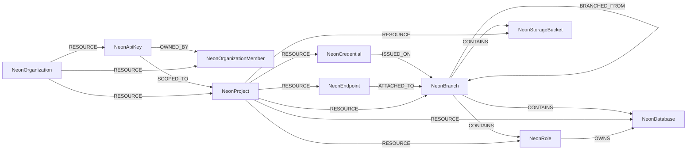

<!-- Generated from the data model. Do not edit manually. -->

## Neon Schema

### NeonApiKey

Represents an organization API key. A key with a `project_id` is limited to that project; one without it can manage every project in the organization.

> **Ontology Mapping**: This node uses the ontology label [`APIKey`](#ontology-apikey).

#### Properties

Ontology-generated fields are shown in *italics*.

| Field | Index | Description |
|-------|-------|-------------|
| id | Yes | The numeric API key id, as a string. The token itself is never returned by the API |
| firstseen |  | Timestamp when a sync job first created this node. |
| lastupdated | Yes | Timestamp of the last sync that observed this node. |
| created_at |  | When the API key was created |
| created_by_id |  | User id of the member who created the key |
| created_by_name |  | Display name of the member who created the key |
| last_used_at |  | When the key last authenticated a request |
| last_used_from_addr |  | The IP address the key was last used from |
| name | Yes | Name of the API key |
| org_id |  | Id of the organization the key belongs to |
| project_id |  | When set, the key is scoped to this single project instead of the whole organization |
| *_ont_created_at* | Yes | Normalized field sourced from `created_at`. |
| *_ont_last_used_at* | Yes | Normalized field sourced from `last_used_at`. |
| *_ont_name* | Yes | Normalized field sourced from `name`. |
| *_ont_source* |  | Module that populated this node's ontology fields. |

#### Relationships

- `(:NeonApiKey)-[:OWNED_BY]->(:NeonOrganizationMember)`

- `(:User)-[:OWNS]->(:NeonApiKey)`: generated by analysis job `Ontology - User OWNS APIKey linking`.

- `(:NeonOrganization)-[:RESOURCE]->(:NeonApiKey)`

- `(:NeonApiKey)-[:SCOPED_TO]->(:NeonProject)`

### NeonBranch

Represents a Neon branch: a copy-on-write clone of the project's data, together with its object storage buckets, roles and databases. A child branch carries a copy of its parent's data, so a branch created from production holds production data.

#### Properties

| Field | Index | Description |
|-------|-------|-------------|
| id | Yes | The branch id (`br-...`), unique across Neon |
| firstseen |  | Timestamp when a sync job first created this node. |
| lastupdated | Yes | Timestamp of the last sync that observed this node. |
| created_at |  | When the branch was created |
| creation_source |  | How the branch was created (`console`, `neonctl`, ...) |
| current_state |  | Lifecycle state of the branch (`init`, `ready`, ...) |
| default |  | Whether this is the project's default branch |
| expires_at |  | When the branch is deleted automatically, if it has an expiry |
| init_source |  | What the branch was seeded with: `parent-data` copies the parent's data, `schema-only` copies only its schema |
| logical_size |  | Logical size of the branch's data, in bytes |
| name | Yes | Name of the branch |
| parent_id |  | Id of the branch this one was created from. Absent on the root branch |
| parent_timestamp |  | Point in the parent's history the branch was created from |
| primary |  | Deprecated alias of `default` still returned by the API |
| project_id |  | Id of the project the branch belongs to |
| protected |  | Whether the branch is protected. When the project's IP allowlist sets `protected_branches_only`, protected branches are the only ones it restricts |
| updated_at |  | When the branch was last changed |

#### Relationships

- `(:NeonEndpoint)-[:ATTACHED_TO]->(:NeonBranch)`

- `(:NeonBranch)-[:BRANCHED_FROM]->(:NeonBranch)`

- `(:NeonBranch)-[:CONTAINS]->(:NeonDatabase)`

- `(:NeonBranch)-[:CONTAINS]->(:NeonRole)`

- `(:NeonBranch)-[:CONTAINS]->(:NeonStorageBucket)`

- `(:NeonCredential)-[:ISSUED_ON]->(:NeonBranch)`

- `(:NeonProject)-[:RESOURCE]->(:NeonBranch)`

### NeonCredential

Represents a scoped branch credential: the access key used for Neon Object Storage (S3), the AI Gateway and Neon Functions. Only metadata is stored, never the secrets.

> **Ontology Mapping**: This node uses the ontology label [`APIKey`](#ontology-apikey).

#### Properties

Ontology-generated fields are shown in *italics*.

| Field | Index | Description |
|-------|-------|-------------|
| id | Yes | The credential's token id (`nak_live_...`). This is an identifier, not a secret: the listing never returns the API token or S3 secret access key |
| firstseen |  | Timestamp when a sync job first created this node. |
| lastupdated | Yes | Timestamp of the last sync that observed this node. |
| branch_id |  | Id of the branch the credential was issued on. Child branches inherit it |
| can_write_storage |  | `True` when the credential holds `storage:write`, so it can overwrite or delete objects in every bucket on its branch |
| created_at |  | When the credential was issued |
| expires_at |  | When the credential expires, if it does |
| function_id |  | Id of the Neon Function the credential was issued to, when it belongs to one |
| last_used_at |  | When the credential was last used |
| name |  | Label of the credential |
| principal_type |  | What kind of principal the credential belongs to (`user`, `function`, ...) |
| revoked_at |  | When the credential was revoked, if it was |
| scopes |  | Capabilities the credential grants (`storage:read`, `storage:write`, `ai_gateway:invoke`, `functions:invoke`, ...) |
| token_id_short | Yes | Short form of the token id shown in the Console |
| *_ont_created_at* | Yes | Normalized field sourced from `created_at`. |
| *_ont_expires_at* | Yes | Normalized field sourced from `expires_at`. |
| *_ont_last_used_at* | Yes | Normalized field sourced from `last_used_at`. |
| *_ont_name* | Yes | Normalized field sourced from `name`. |
| *_ont_source* |  | Module that populated this node's ontology fields. |

#### Relationships

- `(:NeonCredential)-[:ISSUED_ON]->(:NeonBranch)`

- `(:User)-[:OWNS]->(:NeonCredential)`: generated by analysis job `Ontology - User OWNS APIKey linking`.

- `(:NeonProject)-[:RESOURCE]->(:NeonCredential)`

### NeonDatabase

Represents a Postgres database on a Neon branch.

> **Ontology Mapping**: This node uses the ontology label [`Database`](#ontology-database).

#### Properties

Ontology-generated fields are shown in *italics*.

| Field | Index | Description |
|-------|-------|-------------|
| id | Yes | Synthesised as `<branch id>/<database name>` |
| firstseen |  | Timestamp when a sync job first created this node. |
| lastupdated | Yes | Timestamp of the last sync that observed this node. |
| branch_id |  | Id of the branch the database exists on |
| created_at |  | When the database was created |
| database_id |  | The numeric database id returned by the API |
| host | Yes | Hostname of the branch's read-write compute, which is how clients reach this database. Absent when the branch has no read-write compute |
| name | Yes | The Postgres database name |
| owner_name |  | Name of the role that owns the database |
| pg_version |  | The major Postgres version, from the project |
| region_id |  | The region hosting the database, from the project |
| updated_at |  | When the database was last changed |
| *_ont_endpoint* | Yes | Normalized field sourced from `host`. |
| *_ont_location* | Yes | Normalized field sourced from `region_id`. |
| *_ont_name* | Yes | Normalized field sourced from `name`. |
| *_ont_source* |  | Module that populated this node's ontology fields. |
| *_ont_type* | Yes | Property generated by the ontology mapping. |
| *_ont_version* | Yes | Normalized field sourced from `pg_version`. |

#### Relationships

- `(:NeonBranch)-[:CONTAINS]->(:NeonDatabase)`

- `(:NeonRole)-[:OWNS]->(:NeonDatabase)`

- `(:NeonProject)-[:RESOURCE]->(:NeonDatabase)`

### NeonEndpoint

Represents a Neon compute endpoint: the Postgres server that serves one
branch and the hostname clients connect to.

`exposed_internet` is `True` when any internet address may connect to the
compute. The project's IP allowlist, `block_public_connections`, and the
compute's `disabled` flag all feed the verdict. An allowlist with
`protected_branches_only` applies to protected branches only, so a preview
branch's compute stays exposed even when the project looks locked down.

#### Properties

| Field | Index | Description |
|-------|-------|-------------|
| id | Yes | The compute endpoint id (`ep-...`), unique across Neon |
| firstseen |  | Timestamp when a sync job first created this node. |
| lastupdated | Yes | Timestamp of the last sync that observed this node. |
| autoscaling_limit_max_cu |  | Maximum compute size, in compute units |
| autoscaling_limit_min_cu |  | Minimum compute size, in compute units |
| branch_id |  | Id of the branch this compute serves |
| compute_release_version |  | The compute image release |
| created_at |  | When the compute was created |
| creation_source |  | How the compute was created (`console`, `neonctl`, ...) |
| current_state |  | Lifecycle state (`init`, `active`, `idle`) |
| disabled |  | Whether connections to the compute are refused |
| exposed_internet | Yes | `True` when any internet address may open a connection: public connections are not blocked, the compute is not disabled, and no IP allowlist applies to its branch (or the allowlist contains `0.0.0.0/0` or `::/0`) |
| exposed_internet_type | Yes | How it is exposed. Always `direct`, since the hostname resolves to the compute's own proxy |
| host | Yes | The hostname Postgres clients connect to |
| last_active |  | When the compute was last active |
| name |  | Optional display name of the compute endpoint |
| passwordless_access |  | Whether the compute accepts passwordless (Console-brokered) authentication |
| pooled_host | Yes | The hostname of the connection pooler in front of this compute |
| pooler_enabled |  | Whether the deprecated per-endpoint pooler flag is set. The pooled hostname works either way |
| pooler_mode |  | The connection pooler mode |
| region_id |  | The region hosting the compute |
| suspend_timeout_seconds |  | Seconds of inactivity before the compute scales to zero. `0` uses the default, `-1` never suspends |
| type |  | `read_write` for the branch's primary compute, `read_only` for a read replica |
| updated_at |  | When the compute was last changed |

#### Relationships

- `(:NeonEndpoint)-[:ATTACHED_TO]->(:NeonBranch)`

- `(:NeonProject)-[:RESOURCE]->(:NeonEndpoint)`

### NeonOrganization

Represents a Neon organization: the billing and membership boundary that
owns projects, organization members, and organization API keys. Every other
Neon resource belongs to a project.

> **Ontology Mapping**: This node uses the ontology label [`Tenant`](#ontology-tenant).

#### Properties

Ontology-generated fields are shown in *italics*.

| Field | Index | Description |
|-------|-------|-------------|
| id | Yes | The organization id (`org-...`), used in every organization-scoped API path |
| firstseen |  | Timestamp when a sync job first created this node. |
| lastupdated | Yes | Timestamp of the last sync that observed this node. |
| allow_hipaa_projects |  | Whether the organization may create HIPAA-compliant projects |
| created_at |  | When the organization was created |
| handle | Yes | The organization handle shown in Console URLs |
| managed_by |  | Which system manages the organization (`console`, `vercel`, ...) |
| name |  | Display name of the organization |
| plan |  | The organization's subscription plan |
| require_mfa |  | Whether every member must have multi-factor authentication enabled |
| updated_at |  | When the organization was last changed |
| *_ont_name* | Yes | Normalized field sourced from `name`. |
| *_ont_source* |  | Module that populated this node's ontology fields. |

#### Relationships

- `(:NeonOrganization)-[:RESOURCE]->(:NeonApiKey)`

- `(:NeonOrganization)-[:RESOURCE]->(:NeonOrganizationMember)`

- `(:NeonOrganization)-[:RESOURCE]->(:NeonProject)`

### NeonOrganizationMember

Represents a user's membership in a Neon organization, with the role it grants.

> **Ontology Mapping**: This node uses the ontology label [`UserAccount`](#ontology-useraccount).

#### Properties

Ontology-generated fields are shown in *italics*.

| Field | Index | Description |
|-------|-------|-------------|
| id | Yes | The membership id. A user in several organizations has one membership, and so one node, per organization |
| firstseen |  | Timestamp when a sync job first created this node. |
| lastupdated | Yes | Timestamp of the last sync that observed this node. |
| deactivated_at |  | When the member's user account was deactivated, if it was |
| email | Yes | The member's email address |
| has_mfa |  | Whether the member has multi-factor authentication enabled |
| joined_at |  | When the member joined the organization |
| org_id | Yes | Id of the organization this membership belongs to |
| role |  | The member's role in the organization (`admin`, `member`, `editor`, `viewer`, `collaborator`) |
| user_id | Yes | The member's Neon user id, shared across their memberships |
| *_ont_email* | Yes | Normalized field sourced from `email`. |
| *_ont_has_mfa* | Yes | Normalized field sourced from `has_mfa`. |
| *_ont_inactive* | Yes | Normalized field sourced from `deactivated_at`. |
| *_ont_source* |  | Module that populated this node's ontology fields. |

#### Relationships

- `(:User)-[:HAS_ACCOUNT]->(:NeonOrganizationMember)`: generated by analysis job `Ontology - UserAccount HAS_ACCOUNT User linking by normalized email`.

- `(:NeonApiKey)-[:OWNED_BY]->(:NeonOrganizationMember)`

- `(:NeonOrganization)-[:RESOURCE]->(:NeonOrganizationMember)`

### NeonProject

Represents a Neon project: the isolation boundary holding branches, compute endpoints, databases, roles and object storage buckets.

> **Ontology Mapping**: This node uses the ontology label [`Tenant`](#ontology-tenant).

#### Properties

Ontology-generated fields are shown in *italics*.

| Field | Index | Description |
|-------|-------|-------------|
| id | Yes | The project id (e.g. `flat-sea-44148707`), used in every project-scoped API path |
| firstseen |  | Timestamp when a sync job first created this node. |
| lastupdated | Yes | Timestamp of the last sync that observed this node. |
| allowed_ips |  | IP addresses, ranges and CIDRs allowed to connect. An empty or absent value means any address may connect |
| allowed_ips_protected_branches_only |  | When `True`, the IP allowlist applies to protected branches only and every other branch accepts any address |
| audit_log_level |  | Audit log verbosity for the project (`base`, `extended`, `full`) |
| block_public_connections |  | Whether connections over the public internet are refused, leaving only private networking |
| block_vpc_connections |  | Whether connections over VPC endpoints are refused |
| compute_last_active_at |  | When any compute in the project was last active |
| created_at |  | When the project was created |
| creation_source |  | How the project was created (`console`, `neonctl`, ...) |
| enable_logical_replication |  | Whether logical replication is enabled, which lets subscribers stream every change out of the database |
| hipaa |  | Whether the project is HIPAA compliant |
| history_retention_seconds |  | How far back, in seconds, the restore window reaches |
| name |  | Display name of the project |
| org_id |  | Id of the owning organization |
| owner_id |  | Id of the account that owns the project |
| pg_version |  | The major Postgres version of the project |
| platform_id |  | The cloud platform hosting the project |
| proxy_host |  | The regional proxy host that compute endpoint hostnames hang off |
| region_id |  | The region hosting the project (e.g. `aws-us-east-2`) |
| store_passwords |  | Whether Neon stores role passwords so the Console can reveal them |
| updated_at |  | When the project was last changed |
| *_ont_name* | Yes | Normalized field sourced from `name`. |
| *_ont_source* |  | Module that populated this node's ontology fields. |

#### Relationships

- `(:NeonProject)-[:RESOURCE]->(:NeonBranch)`

- `(:NeonProject)-[:RESOURCE]->(:NeonCredential)`

- `(:NeonProject)-[:RESOURCE]->(:NeonDatabase)`

- `(:NeonProject)-[:RESOURCE]->(:NeonEndpoint)`

- `(:NeonOrganization)-[:RESOURCE]->(:NeonProject)`

- `(:NeonProject)-[:RESOURCE]->(:NeonRole)`

- `(:NeonProject)-[:RESOURCE]->(:NeonStorageBucket)`

- `(:NeonApiKey)-[:SCOPED_TO]->(:NeonProject)`

### NeonRole

Represents a Postgres role on a Neon branch. The listing can carry a role password, which is dropped and never stored.

#### Properties

| Field | Index | Description |
|-------|-------|-------------|
| id | Yes | Synthesised as `<branch id>/<role name>` |
| firstseen |  | Timestamp when a sync job first created this node. |
| lastupdated | Yes | Timestamp of the last sync that observed this node. |
| authentication_method |  | How the role authenticates (`password`, `no_login`, ...) |
| branch_id |  | Id of the branch the role exists on |
| created_at |  | When the role was created |
| name | Yes | The Postgres role name |
| protected |  | Whether this is a system role Neon manages and users cannot modify |
| updated_at |  | When the role was last changed |

#### Relationships

- `(:NeonBranch)-[:CONTAINS]->(:NeonRole)`

- `(:NeonRole)-[:OWNS]->(:NeonDatabase)`

- `(:NeonProject)-[:RESOURCE]->(:NeonRole)`

### NeonStorageBucket

Represents a Neon Object Storage bucket as served by one branch.

Buckets branch with the database: a child branch serves its own copy of its
parent's buckets from its own S3 endpoint, so Cartography records one node
per branch. `exposed_internet` is `True` for `public_read` buckets, which the
`object_storage_public` rule reports.

> **Ontology Mapping**: This node uses the ontology label [`ObjectStorage`](#ontology-objectstorage).

#### Properties

Ontology-generated fields are shown in *italics*.

| Field | Index | Description |
|-------|-------|-------------|
| id | Yes | Synthesised as `<branch id>/<bucket name>` |
| firstseen |  | Timestamp when a sync job first created this node. |
| lastupdated | Yes | Timestamp of the last sync that observed this node. |
| access_level |  | `public_read` lets anyone read objects without credentials, `private` requires a credential |
| branch_id |  | Id of the branch serving this copy of the bucket |
| created_at |  | When the bucket was created |
| exposed_internet | Yes | `True` when the bucket is `public_read`, meaning every object is readable without authentication |
| exposed_internet_type | Yes | How it is exposed. Always `direct`, since objects are served from the branch's own S3 endpoint |
| name | Yes | Name of the bucket |
| public |  | `True` when `access_level` is `public_read` |
| region |  | The S3 signing region of the branch's storage |
| s3_endpoint |  | The branch's S3-compatible endpoint URL. Objects are addressed path-style as `<s3_endpoint>/<bucket>/<key>` |
| url | Yes | The bucket's base URL, `<s3_endpoint>/<bucket>`. For a `public_read` bucket every object under it is readable without credentials |
| *_ont_location* | Yes | Normalized field sourced from `region`. |
| *_ont_name* | Yes | Normalized field sourced from `name`. |
| *_ont_public* | Yes | Normalized field sourced from `public`. |
| *_ont_source* |  | Module that populated this node's ontology fields. |

#### Relationships

- `(:NeonBranch)-[:CONTAINS]->(:NeonStorageBucket)`

- `(:NeonProject)-[:RESOURCE]->(:NeonStorageBucket)`
