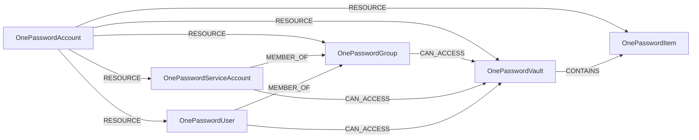

<!-- Generated from the data model. Do not edit manually. -->

## 1Password Schema

### OnePasswordAccount

A 1Password account (business tenant) described by a collector snapshot.

> **Ontology Mapping**: This node uses the ontology label [`Tenant`](#ontology-tenant).

#### Properties

| Field | Index | Description |
|-------|-------|-------------|
| id | Yes | 1Password account UUID, lowercased by the collector. |
| firstseen |  | Timestamp when a sync job first created this node. |
| lastupdated | Yes | Timestamp of the last sync that observed this node. |
| collector_version |  | Version of the collector that produced the ingested snapshot. |
| snapshot_collected_at |  | UTC time when the collector finished the ingested snapshot. Use it to judge how current the account's access data is. |
| snapshot_id |  | Unique ID of the collector run that produced the ingested snapshot. |
| vault_scope |  | IDs of the vaults the snapshot covers. Vaults outside this list are not collected. |

#### Relationships

- `(:OnePasswordAccount)-[:RESOURCE]->(:OnePasswordGroup)`: Scopes a 1Password resource to the account that owns it.

- `(:OnePasswordAccount)-[:RESOURCE]->(:OnePasswordItem)`: Scopes a 1Password resource to the account that owns it.

- `(:OnePasswordAccount)-[:RESOURCE]->(:OnePasswordServiceAccount)`: Scopes a 1Password resource to the account that owns it.

- `(:OnePasswordAccount)-[:RESOURCE]->(:OnePasswordUser)`: Scopes a 1Password resource to the account that owns it.

- `(:OnePasswordAccount)-[:RESOURCE]->(:OnePasswordVault)`: Scopes a 1Password resource to the account that owns it.

### OnePasswordGroup

A 1Password group. Members inherit the group's vault access.

> **Ontology Mapping**: This node uses the ontology label [`UserGroup`](#ontology-usergroup).

#### Properties

Ontology-generated fields are shown in *italics*.

| Field | Index | Description |
|-------|-------|-------------|
| id | Yes | 1Password group UUID. |
| firstseen |  | Timestamp when a sync job first created this node. |
| lastupdated | Yes | Timestamp of the last sync that observed this node. |
| name | Yes | Group name, such as `Owners`, `Administrators`, or a custom group name. |
| *_ont_name* | Yes | Normalized field sourced from `name`. |
| *_ont_source* |  | Module that populated this node's ontology fields. |

#### Relationships

- `(:OnePasswordGroup)-[:CAN_ACCESS]->(:OnePasswordVault)`: A vault grant to a group. Every group member receives these permissions.
  - Properties:

    | Field | Description |
    |-------|-------------|
    | permissions | Lowercase names of the granted vault permissions, such as `read_items`, `reveal_item_password`, and `manage_vault`. |
    | permissions_bitmask | Raw permission bitmask from the 1Password SDK. It keeps bits that have no name in `permissions`. |

- `(:OnePasswordServiceAccount)-[:MEMBER_OF]->(:OnePasswordGroup)`: Membership of a user or service account in a 1Password group.

- `(:OnePasswordUser)-[:MEMBER_OF]->(:OnePasswordGroup)`: Membership of a user or service account in a 1Password group.

- `(:OnePasswordAccount)-[:RESOURCE]->(:OnePasswordGroup)`: Scopes a 1Password resource to the account that owns it.

### OnePasswordItem

Metadata for a 1Password item, such as a login or API credential. The graph
never stores item fields or secret values.

> **Ontology Mapping**: This node uses the ontology label [`Secret`](#ontology-secret).

#### Properties

Ontology-generated fields are shown in *italics*.

| Field | Index | Description |
|-------|-------|-------------|
| id | Yes | 1Password item UUID. |
| firstseen |  | Timestamp when a sync job first created this node. |
| lastupdated | Yes | Timestamp of the last sync that observed this node. |
| category | Yes | Item category, such as `LOGIN`, `API_CREDENTIAL`, `SSH_KEY`, or `SECURE_NOTE`. |
| created_at |  | Time when the item was created. |
| state |  | Item state reported by 1Password, such as `ARCHIVED`. |
| title |  | Item title. Absent when the collector runs with `--omit-titles`. |
| updated_at |  | Time when the item was last updated. |
| vault_id |  | UUID of the vault that contains the item. |
| version |  | Item version. 1Password increments it on every change. |
| *_ont_created_at* | Yes | Normalized field sourced from `created_at`. |
| *_ont_name* | Yes | Normalized field sourced from `title`. |
| *_ont_source* |  | Module that populated this node's ontology fields. |
| *_ont_updated_at* | Yes | Normalized field sourced from `updated_at`. |

#### Relationships

- `(:OnePasswordVault)-[:CONTAINS]->(:OnePasswordItem)`: Places an item in its vault. Vault access grants access to the item.

- `(:OnePasswordAccount)-[:RESOURCE]->(:OnePasswordItem)`: Scopes a 1Password resource to the account that owns it.

### OnePasswordServiceAccount

A 1Password service account: a non-human identity that automation uses to
read or write vault items.

> **Ontology Mapping**: This node uses the ontology label [`ServiceAccount`](#ontology-serviceaccount).

#### Properties

Ontology-generated fields are shown in *italics*.

| Field | Index | Description |
|-------|-------|-------------|
| id | Yes | 1Password service account UUID. |
| firstseen |  | Timestamp when a sync job first created this node. |
| lastupdated | Yes | Timestamp of the last sync that observed this node. |
| name |  | Display name of the service account. 1Password omits it for the collector's own service account. |
| state |  | Service account state reported by 1Password, such as `ACTIVE`. |
| *_ont_active* | Yes | Normalized field sourced from `state`. |
| *_ont_name* | Yes | Normalized field sourced from `name`. |
| *_ont_source* |  | Module that populated this node's ontology fields. |

#### Relationships

- `(:OnePasswordServiceAccount)-[:CAN_ACCESS]->(:OnePasswordVault)`: A direct vault grant to a service account.
  - Properties:

    | Field | Description |
    |-------|-------------|
    | permissions | Lowercase names of the granted vault permissions, such as `read_items`, `reveal_item_password`, and `manage_vault`. |
    | permissions_bitmask | Raw permission bitmask from the 1Password SDK. It keeps bits that have no name in `permissions`. |

- `(:OnePasswordServiceAccount)-[:MEMBER_OF]->(:OnePasswordGroup)`: Membership of a user or service account in a 1Password group.

- `(:OnePasswordAccount)-[:RESOURCE]->(:OnePasswordServiceAccount)`: Scopes a 1Password resource to the account that owns it.

### OnePasswordUser

A person's account in 1Password, including guests and pending invitations.

> **Ontology Mapping**: This node uses the ontology label [`UserAccount`](#ontology-useraccount).

#### Properties

Ontology-generated fields are shown in *italics*.

| Field | Index | Description |
|-------|-------|-------------|
| id | Yes | 1Password user UUID. |
| firstseen |  | Timestamp when a sync job first created this node. |
| lastupdated | Yes | Timestamp of the last sync that observed this node. |
| email | Yes | Email address of the user. |
| name |  | Display name of the user. |
| state |  | Account state reported by 1Password, such as `ACTIVE`, `PENDING`, or `SUSPENDED`. The ontology marks `SUSPENDED`, `PROVISION_SUSPENDED`, and `DELETED` users inactive. |
| type |  | User type reported by 1Password, such as `MEMBER` or `GUEST`. |
| *_ont_email* | Yes | Normalized field sourced from `email`. |
| *_ont_fullname* | Yes | Normalized field sourced from `name`. |
| *_ont_inactive* | Yes | Normalized field sourced from `state`. |
| *_ont_source* |  | Module that populated this node's ontology fields. |

#### Relationships

- `(:OnePasswordUser)-[:CAN_ACCESS]->(:OnePasswordVault)`: A direct vault grant to a user. Access through groups is a separate path.
  - Properties:

    | Field | Description |
    |-------|-------------|
    | permissions | Lowercase names of the granted vault permissions, such as `read_items`, `reveal_item_password`, and `manage_vault`. |
    | permissions_bitmask | Raw permission bitmask from the 1Password SDK. It keeps bits that have no name in `permissions`. |

- `(:User)-[:HAS_ACCOUNT]->(:OnePasswordUser)`

- `(:OnePasswordUser)-[:MEMBER_OF]->(:OnePasswordGroup)`: Membership of a user or service account in a 1Password group.

- `(:OnePasswordAccount)-[:RESOURCE]->(:OnePasswordUser)`: Scopes a 1Password resource to the account that owns it.

### OnePasswordVault

A 1Password vault in the collector's configured scope.

#### Properties

| Field | Index | Description |
|-------|-------|-------------|
| id | Yes | 1Password vault UUID. |
| firstseen |  | Timestamp when a sync job first created this node. |
| lastupdated | Yes | Timestamp of the last sync that observed this node. |
| name |  | Vault name. Absent when the collector runs with `--omit-titles`. |

#### Relationships

- `(:OnePasswordGroup)-[:CAN_ACCESS]->(:OnePasswordVault)`: A vault grant to a group. Every group member receives these permissions.
  - Properties:

    | Field | Description |
    |-------|-------------|
    | permissions | Lowercase names of the granted vault permissions, such as `read_items`, `reveal_item_password`, and `manage_vault`. |
    | permissions_bitmask | Raw permission bitmask from the 1Password SDK. It keeps bits that have no name in `permissions`. |

- `(:OnePasswordServiceAccount)-[:CAN_ACCESS]->(:OnePasswordVault)`: A direct vault grant to a service account.
  - Properties:

    | Field | Description |
    |-------|-------------|
    | permissions | Lowercase names of the granted vault permissions, such as `read_items`, `reveal_item_password`, and `manage_vault`. |
    | permissions_bitmask | Raw permission bitmask from the 1Password SDK. It keeps bits that have no name in `permissions`. |

- `(:OnePasswordUser)-[:CAN_ACCESS]->(:OnePasswordVault)`: A direct vault grant to a user. Access through groups is a separate path.
  - Properties:

    | Field | Description |
    |-------|-------------|
    | permissions | Lowercase names of the granted vault permissions, such as `read_items`, `reveal_item_password`, and `manage_vault`. |
    | permissions_bitmask | Raw permission bitmask from the 1Password SDK. It keeps bits that have no name in `permissions`. |

- `(:OnePasswordVault)-[:CONTAINS]->(:OnePasswordItem)`: Places an item in its vault. Vault access grants access to the item.

- `(:OnePasswordAccount)-[:RESOURCE]->(:OnePasswordVault)`: Scopes a 1Password resource to the account that owns it.
