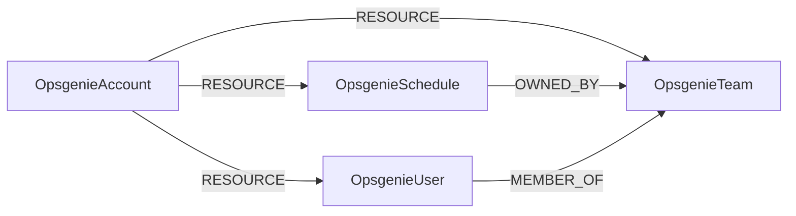

<!-- Generated from the data model. Do not edit manually. -->

## Opsgenie Schema

### OpsgenieAccount

An Opsgenie account.

> **Ontology Mapping**: This node uses the ontology label [`Tenant`](#ontology-tenant).

#### Properties

Ontology-generated fields are shown in *italics*.

| Field | Index | Description |
|-------|-------|-------------|
| id | Yes | Opsgenie account name. |
| firstseen |  | Timestamp when a sync job first created this node. |
| lastupdated | Yes | Timestamp of the last sync that observed this node. |
| max_user_count |  | Maximum users allowed by the account plan. |
| name |  | Opsgenie account name. |
| plan_name |  | Name of the account plan. |
| user_count |  | Number of users in the account. |
| *_ont_name* | Yes | Normalized field sourced from `name`. |
| *_ont_source* |  | Module that populated this node's ontology fields. |

#### Relationships

- `(:OpsgenieAccount)-[:RESOURCE]->(:OpsgenieSchedule)`: The account contains the schedule.

- `(:OpsgenieAccount)-[:RESOURCE]->(:OpsgenieTeam)`: The account contains the team.

- `(:OpsgenieAccount)-[:RESOURCE]->(:OpsgenieUser)`: The account contains the user.

### OpsgenieSchedule

An on-call schedule in an Opsgenie account.

#### Properties

| Field | Index | Description |
|-------|-------|-------------|
| id | Yes | Opsgenie schedule ID. |
| firstseen |  | Timestamp when a sync job first created this node. |
| lastupdated | Yes | Timestamp of the last sync that observed this node. |
| description |  | Schedule description. |
| enabled |  | Whether the schedule is enabled. |
| name | Yes | Schedule name. |
| timezone |  | Schedule time zone. |

#### Relationships

- `(:OpsgenieSchedule)-[:OWNED_BY]->(:OpsgenieTeam)`: The team owns the schedule.

- `(:OpsgenieAccount)-[:RESOURCE]->(:OpsgenieSchedule)`: The account contains the schedule.

### OpsgenieTeam

A team in an Opsgenie account.

> **Ontology Mapping**: This node uses the ontology label [`UserGroup`](#ontology-usergroup).

#### Properties

Ontology-generated fields are shown in *italics*.

| Field | Index | Description |
|-------|-------|-------------|
| id | Yes | Opsgenie team ID. |
| firstseen |  | Timestamp when a sync job first created this node. |
| lastupdated | Yes | Timestamp of the last sync that observed this node. |
| description |  | Team description. |
| name | Yes | Team name. |
| *_ont_description* |  | Normalized field sourced from `description`. |
| *_ont_name* | Yes | Normalized field sourced from `name`. |
| *_ont_source* |  | Module that populated this node's ontology fields. |

#### Relationships

- `(:OpsgenieUser)-[:MEMBER_OF]->(:OpsgenieTeam)`: The user is a member of the team.

- `(:OpsgenieSchedule)-[:OWNED_BY]->(:OpsgenieTeam)`: The team owns the schedule.

- `(:OpsgenieAccount)-[:RESOURCE]->(:OpsgenieTeam)`: The account contains the team.

### OpsgenieUser

A user in an Opsgenie account.

> **Ontology Mapping**: This node uses the ontology label [`UserAccount`](#ontology-useraccount).

#### Properties

Ontology-generated fields are shown in *italics*.

| Field | Index | Description |
|-------|-------|-------------|
| id | Yes | Opsgenie user ID. |
| firstseen |  | Timestamp when a sync job first created this node. |
| lastupdated | Yes | Timestamp of the last sync that observed this node. |
| blocked |  | Whether the user is blocked. |
| created_at |  | ISO 8601 timestamp when the user was created. |
| full_name |  | User display name. |
| locale |  | User locale. |
| role |  | User role name. |
| timezone |  | User time zone. |
| username | Yes | User email address. |
| verified |  | Whether the user is verified. |
| *_ont_active* | Yes | Normalized field sourced from `blocked`. |
| *_ont_email* | Yes | Normalized field sourced from `username`. |
| *_ont_fullname* | Yes | Normalized field sourced from `full_name`. |
| *_ont_source* |  | Module that populated this node's ontology fields. |

#### Relationships

- `(:User)-[:HAS_ACCOUNT]->(:OpsgenieUser)`

- `(:OpsgenieUser)-[:MEMBER_OF]->(:OpsgenieTeam)`: The user is a member of the team.

- `(:OpsgenieAccount)-[:RESOURCE]->(:OpsgenieUser)`: The account contains the user.
