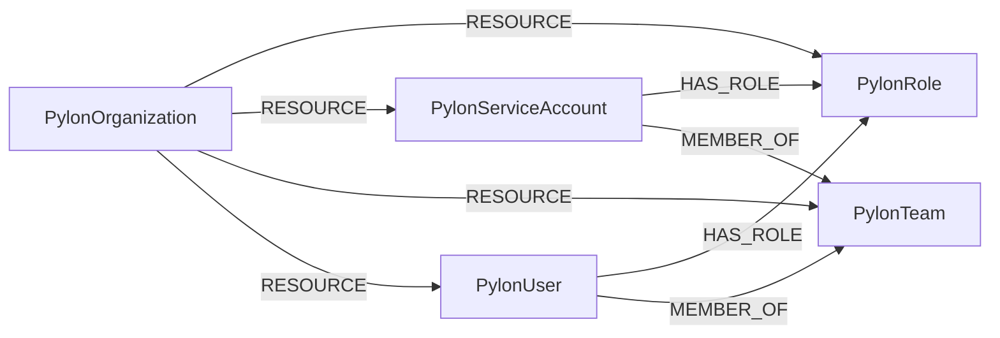

<!-- Generated from the data model. Do not edit manually. -->

## Pylon Schema

### PylonOrganization

A Pylon organization (workspace), read from the `GET /me` endpoint.

The organization is the tenant for every other Pylon node. Cartography
reads only workspace identity and access data: users, API token
identities and bots, roles, and teams.
It doesn't read customer data such as accounts, contacts, or issues.

> **Ontology Mapping**: This node uses the ontology label [`Tenant`](#ontology-tenant).

#### Properties

Ontology-generated fields are shown in *italics*.

| Field | Index | Description |
|-------|-------|-------------|
| id | Yes | Pylon organization ID. |
| firstseen |  | Timestamp when a sync job first created this node. |
| lastupdated | Yes | Timestamp of the last sync that observed this node. |
| base_url |  | Pylon API base URL that the organization was read from, which identifies its region (US or EU). |
| name |  | Organization name. |
| *_ont_name* | Yes | Normalized field sourced from `name`. |
| *_ont_source* |  | Module that populated this node's ontology fields. |

#### Relationships

- `(:PylonOrganization)-[:RESOURCE]->(:PylonRole)`: The organization contains the role.

- `(:PylonOrganization)-[:RESOURCE]->(:PylonServiceAccount)`: The organization contains the service account.

- `(:PylonOrganization)-[:RESOURCE]->(:PylonTeam)`: The organization contains the team.

- `(:PylonOrganization)-[:RESOURCE]->(:PylonUser)`: The organization contains the user.

### PylonRole

A user role in a Pylon organization, read from `GET /user-roles`.

Pylon has built-in roles, such as Admin and Member, and custom roles on the
Enterprise plan. The API doesn't say which roles are built in. API tokens
with their own identity also hold a role, but the API can't list tokens.

> **Ontology Mapping**: This node uses the ontology label [`PermissionRole`](#ontology-permissionrole).

#### Properties

Ontology-generated fields are shown in *italics*.

| Field | Index | Description |
|-------|-------|-------------|
| id | Yes | Pylon role ID. |
| firstseen |  | Timestamp when a sync job first created this node. |
| lastupdated | Yes | Timestamp of the last sync that observed this node. |
| field_restricted_permissions |  | Sorted list of granted actions that also hide or lock fields through restrictions that the Pylon API can't represent. |
| filtered_permissions |  | Sorted list of granted actions that apply only to objects that match a filter, including filters that the Pylon API can't represent. |
| issue_access_default_actions |  | Sorted list of actions that the role grants on an issue that matches none of its issue access rules. |
| issue_access_rule_count |  | Number of issue access rules that limit which issues the role can access. |
| name |  | Role name. |
| permissions |  | Sorted list of actions that the role grants, for example `read:issue`. An action can apply only to the objects that match a filter; see `filtered_permissions`. |
| slug | Yes | Role slug, for example `admin`. |
| *_ont_name* | Yes | Normalized field sourced from `name`. |
| *_ont_scope* | Yes | Property generated by the ontology mapping. |
| *_ont_source* |  | Module that populated this node's ontology fields. |

#### Relationships

- `(:PylonServiceAccount)-[:HAS_ROLE]->(:PylonRole)`: The service account is assigned the role, which is all a token can do.

- `(:PylonUser)-[:HAS_ROLE]->(:PylonRole)`: The user is assigned the role, directly or through a SCIM group mapping.

- `(:PylonOrganization)-[:RESOURCE]->(:PylonRole)`: The organization contains the role.

### PylonServiceAccount

A non-human identity in a Pylon organization, read from `GET /users`.

`GET /users` also returns API tokens that have their own identity and bots.
These entries have no email address, because API identities and bots can't
sign in, so Cartography loads every user without an email as a
`PylonServiceAccount`. The API doesn't distinguish tokens from bots, and it
doesn't return a token's value, creator, last use, or IP allowlist. Pylon
tokens don't expire and have no scopes, so the assigned role is the
token's entire access.

> **Ontology Mapping**: This node uses the ontology label [`ServiceAccount`](#ontology-serviceaccount).

#### Properties

Ontology-generated fields are shown in *italics*.

| Field | Index | Description |
|-------|-------|-------------|
| id | Yes | Pylon user ID of the identity. |
| firstseen |  | Timestamp when a sync job first created this node. |
| lastupdated | Yes | Timestamp of the last sync that observed this node. |
| is_deactivated |  | Whether the identity is deactivated. |
| name |  | Name of the API token or bot. |
| *_ont_active* | Yes | Normalized field sourced from `is_deactivated`. |
| *_ont_name* | Yes | Normalized field sourced from `name`. |
| *_ont_source* |  | Module that populated this node's ontology fields. |

#### Relationships

- `(:PylonServiceAccount)-[:HAS_ROLE]->(:PylonRole)`: The service account is assigned the role, which is all a token can do.

- `(:PylonServiceAccount)-[:MEMBER_OF]->(:PylonTeam)`: The service account is a member of the team.

- `(:PylonOrganization)-[:RESOURCE]->(:PylonServiceAccount)`: The organization contains the service account.

### PylonTeam

A team in a Pylon organization, read from `GET /teams`.

Teams group users for issue routing. Cartography doesn't read team
schedules.

> **Ontology Mapping**: This node uses the ontology label [`UserGroup`](#ontology-usergroup).

#### Properties

Ontology-generated fields are shown in *italics*.

| Field | Index | Description |
|-------|-------|-------------|
| id | Yes | Pylon team ID. |
| firstseen |  | Timestamp when a sync job first created this node. |
| lastupdated | Yes | Timestamp of the last sync that observed this node. |
| assignment_method |  | How the team routes issues to its members: `routing`, `schedule`, `manual`, or `pull_queue`. |
| name |  | Team name. |
| *_ont_name* | Yes | Normalized field sourced from `name`. |
| *_ont_source* |  | Module that populated this node's ontology fields. |

#### Relationships

- `(:PylonServiceAccount)-[:MEMBER_OF]->(:PylonTeam)`: The service account is a member of the team.

- `(:PylonUser)-[:MEMBER_OF]->(:PylonTeam)`: The user is a member of the team.

- `(:PylonOrganization)-[:RESOURCE]->(:PylonTeam)`: The organization contains the team.

### PylonUser

A person's account in a Pylon organization, read from `GET /users`.

Cartography includes deactivated users so that stale access stays visible.
Entries without an email address are API tokens or bots, which Cartography
loads as `PylonServiceAccount` instead. The `UserAccount` label links the
user to the canonical `User` node by email address.

> **Ontology Mapping**: This node uses the ontology label [`UserAccount`](#ontology-useraccount).

#### Properties

Ontology-generated fields are shown in *italics*.

| Field | Index | Description |
|-------|-------|-------------|
| id | Yes | Pylon user ID. |
| firstseen |  | Timestamp when a sync job first created this node. |
| lastupdated | Yes | Timestamp of the last sync that observed this node. |
| email | Yes | Primary email address of the user. |
| emails |  | All email addresses of the user. |
| is_deactivated |  | Whether the user is deactivated. A deactivated user can't sign in, and Pylon deletes the API tokens that the user created. |
| name |  | User name. |
| *_ont_active* | Yes | Normalized field sourced from `is_deactivated`. |
| *_ont_email* | Yes | Normalized field sourced from `email`. |
| *_ont_fullname* | Yes | Normalized field sourced from `name`. |
| *_ont_source* |  | Module that populated this node's ontology fields. |

#### Relationships

- `(:User)-[:HAS_ACCOUNT]->(:PylonUser)`: generated by analysis job `Ontology - UserAccount HAS_ACCOUNT User linking by normalized email`.

- `(:PylonUser)-[:HAS_ROLE]->(:PylonRole)`: The user is assigned the role, directly or through a SCIM group mapping.

- `(:PylonUser)-[:MEMBER_OF]->(:PylonTeam)`: The user is a member of the team.

- `(:PylonOrganization)-[:RESOURCE]->(:PylonUser)`: The organization contains the user.
