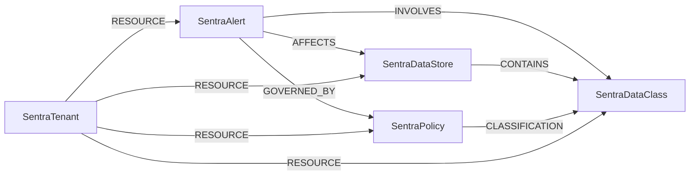

<!-- Generated from the data model. Do not edit manually. -->

## Sentra Schema

### SentraAlert

An active Sentra alert: a policy violation on a data store or identity.

The Sentra UI calls these issues. Cartography imports alerts whose status is
`pending`, `opened`, or `in_progress`; cleanup removes alerts that Sentra
resolved or ignored since the last sync.

For an alert on a data store, Cartography also reads the objects that violate
the policy, such as files in a bucket. The alert links with `INVOLVES` to the
data classes found in those objects, and with `AFFECTS` to the stores that hold
them. Cartography doesn't create nodes for the objects themselves.

When an affected data store represents an AWS resource, the alert also links
with `AFFECTS` directly to that resource, as findings from other security
tools do. Queries that match `(:SecurityIssue)-[:AFFECTS]->(:ObjectStorage)`
then include alerts on S3 buckets, and queries that match
`(:SecurityIssue)-[:AFFECTS]->(:Database)` include alerts on RDS instances,
DynamoDB tables, and Redshift clusters. An RDS cluster has no `Database`
label, because its member instances carry it.

> **Ontology Mapping**: This node uses the ontology label [`SecurityIssue`](#ontology-securityissue).

#### Properties

Ontology-generated fields are shown in *italics*.

| Field | Index | Description |
|-------|-------|-------------|
| id | Yes | Sentra alert ID. |
| firstseen |  | Timestamp when a sync job first created this node. |
| lastupdated | Yes | Timestamp when this Sentra alert was last seen. |
| alert_type | Yes | Alert type, for example `VIOLATED_STORE` or `VIOLATED_IAM_ROLE`. |
| connector_account_id |  | Cloud or SaaS account ID of the connector that the alert belongs to. |
| connector_account_type |  | Connector account type, for example `AWS`. |
| connector_id |  | ID of the Sentra connector the alert belongs to. |
| created_at |  | Timestamp when Sentra created the alert. |
| data_class_ids |  | IDs of the Sentra data classes found on the violating entity. |
| description |  | Alert description. |
| entity_cloud_unique_id |  | Provider-native identifier of the violating entity, as reported by Sentra. |
| entity_id | Yes | Sentra ID of the violating entity. |
| entity_name |  | Name of the violating entity. |
| entity_type | Yes | Type of the violating entity, for example `STORE` or `IAM_ROLE`. |
| frameworks |  | Compliance frameworks of the policy, for example `GDPR` or `HIPAA`. |
| last_modified |  | Timestamp when the alert was last modified. |
| name | Yes | Name of the policy that raised the alert. |
| occurrences |  | Number of times the alert recurred. |
| opened_at |  | Timestamp when the alert was opened. |
| policy_id | Yes | ID of the Sentra policy that raised the alert. |
| policy_type |  | Type of the Sentra policy that raised the alert. |
| recommendation |  | Sentra remediation guidance for the alert. |
| risk_type |  | Risk category of the policy, for example `exposed_data` or `excessive_access`. |
| sensitivity_level |  | Sentra sensitivity level of the violating entity. |
| severity | Yes | Alert severity: `low`, `medium`, `high`, or `critical`. |
| status | Yes | Alert status: `pending`, `opened`, or `in_progress`. |
| status_reason |  | Reason for the current status, for example `reopened`. |
| tags |  | Tags on the policy that raised the alert. |
| total_violated_assets_count |  | Number of assets that violate the policy. |
| *_ont_first_seen* | Yes | Normalized field sourced from `created_at`. |
| *_ont_severity* | Yes | Normalized field sourced from `severity`. |
| *_ont_source* |  | Module that populated this node's ontology fields. |
| *_ont_status* | Yes | Normalized field sourced from `status`. |
| *_ont_title* | Yes | Normalized field sourced from `name`. |
| *_ont_type* | Yes | Normalized field sourced from `alert_type`. |

#### Relationships

- `(:SentraAlert)-[:AFFECTS]->(:AWSDynamoDBTable)`: The DynamoDB table that a data store affected by the alert represents, matched on the table ARN.

- `(:SentraAlert)-[:AFFECTS]->(:AWSRDSCluster)`: The RDS DB cluster that a data store affected by the alert represents, matched on the cluster ARN.

- `(:SentraAlert)-[:AFFECTS]->(:AWSRDSInstance)`: The RDS DB instance that a data store affected by the alert represents, matched on the instance ARN.

- `(:SentraAlert)-[:AFFECTS]->(:AWSRedshiftCluster)`: The Redshift cluster that a data store affected by the alert represents, matched on the cluster ARN.

- `(:SentraAlert)-[:AFFECTS]->(:AWSRole)`: The IAM role that Sentra raised the alert on, matched on the role ARN.

- `(:SentraAlert)-[:AFFECTS]->(:AWSS3Bucket)`: The S3 bucket that a data store affected by the alert represents, matched on the bucket name.

- `(:SentraAlert)-[:AFFECTS]->(:SentraDataStore)`: A data store that the alert affects: the store that Sentra raised the alert on, or a store that holds an object that violates the policy.

- `(:SentraAlert)-[:GOVERNED_BY]->(:SentraPolicy)`: The policy that raised the alert.

- `(:SentraAlert)-[:INVOLVES]->(:SentraDataClass)`: A data class that Sentra found in an object that violates the policy.

- `(:SentraTenant)-[:RESOURCE]->(:SentraAlert)`: The Sentra organization that raised the alert.

### SentraDataClass

A Sentra data class: a kind of sensitive data that Sentra classifies, such as email addresses or API keys.

#### Properties

| Field | Index | Description |
|-------|-------|-------------|
| id | Yes | Sentra data class ID. |
| firstseen |  | Timestamp when a sync job first created this node. |
| lastupdated | Yes | Timestamp when this Sentra data class was last seen. |
| category | Yes | Data class category, for example `Personal`, `Financial`, or `Credentials`. |
| class_type |  | Detection level: `FINDING_LEVEL` or `ASSET_LEVEL`. |
| created_at |  | Timestamp when the data class was created. |
| description |  | Data class description. |
| enabled |  | Whether Sentra scans for this data class. |
| experimental |  | Whether the data class is experimental. |
| findings_count |  | Number of findings that Sentra detected for this data class. |
| is_ai |  | Whether the data class targets AI and ML data. |
| name | Yes | Data class name, for example `Social Security Number`. |
| sensitivity_weight |  | Sensitivity weight of the data class. Higher values mean more sensitive data. |
| source |  | Class origin: `SENTRA` for predefined classes or `MANUAL` for custom classes. |

#### Relationships

- `(:SentraPolicy)-[:CLASSIFICATION]->(:SentraDataClass)`: A data class that the policy rules check for, matched on the class name or on its category.

- `(:SentraDataStore)-[:CONTAINS]->(:SentraDataClass)`: A kind of sensitive data that Sentra found in the data store.

- `(:SentraAlert)-[:INVOLVES]->(:SentraDataClass)`: A data class that Sentra found in an object that violates the policy.

- `(:SentraTenant)-[:RESOURCE]->(:SentraDataClass)`: The Sentra organization that defines the data class.

### SentraDataStore

A data store that Sentra discovered and classified, such as an S3 bucket, a database, or a SaaS drive.

The node is Sentra's view of the store: its sensitivity, the data classes found in it,
and its security posture. Where Sentra's identifier proves which AWS resource the store
is, the node links to that resource with `MONITORS`. Data stores in other clouds and in
SaaS applications have no `MONITORS` link.

#### Properties

| Field | Index | Description |
|-------|-------|-------------|
| id | Yes | Sentra data store ID. |
| firstseen |  | Timestamp when a sync job first created this node. |
| lastupdated | Yes | Timestamp when this Sentra data store was last seen. |
| alerts_count |  | Number of Sentra alerts on the data store. |
| category |  | Data store category, for example `RDBMS`, `NoSQL`, or `Object Storage`. |
| connector_account_id | Yes | Cloud or SaaS account ID of the connector, for example an AWS account ID. |
| connector_account_type |  | Connector account type, for example `AWS`, `GCP`, `AZURE`, or `SNOWFLAKE`. |
| connector_environment |  | Connector environment, for example `production`. |
| connector_id |  | ID of the Sentra connector that discovered the data store. |
| connector_name |  | Display name of the Sentra connector that discovered the data store. |
| created_at |  | Timestamp when the data store was created in the source system. |
| database_engine |  | Database engine, for example `postgres` or `mysql`. |
| database_engine_version |  | Database engine version. |
| description |  | Data store description. |
| encryption_method |  | Cloud-prefixed encryption method, for example `S3:SSE-KMS`. |
| findings_count |  | Number of sensitive data findings in the data store. |
| hosting_service | Yes | Service hosting the data store, for example `s3` or `rds`. |
| is_backed_up |  | Whether backups are enabled for the data store. |
| is_encrypted |  | Whether the data store is encrypted at rest. |
| is_encrypted_in_transit |  | Whether the data store is encrypted in transit. |
| is_logging_enabled |  | Whether logging is enabled for the data store. |
| is_managed |  | Whether the data store is a managed service. |
| last_activity |  | Timestamp when the data in the store was last accessed. |
| last_classified |  | Timestamp when Sentra last classified the data store. |
| last_modified |  | Timestamp when the data store was last modified. |
| last_scan_status |  | Status of the most recent Sentra scan. |
| last_scanned |  | Timestamp of the most recent Sentra scan. |
| name | Yes | Data store name as shown in Sentra. |
| native_unique_id | Yes | Provider-native identifier of the data store, as reported by Sentra. |
| public_access_level |  | Public access level: `private`, `public`, `can_be_public`, or `unknown`. |
| region |  | Cloud region of the data store. |
| scan_status |  | Current Sentra scan status. |
| sensitivity_level | Yes | Sentra sensitivity level. `0` means that the store holds no sensitive data, and higher values mean more sensitive data. |
| sensitivity_score |  | Sentra sensitivity score. |
| storage_account |  | Azure storage account that holds the data store. |
| used_storage |  | Used storage in bytes. |

#### Relationships

- `(:SentraAlert)-[:AFFECTS]->(:SentraDataStore)`: A data store that the alert affects: the store that Sentra raised the alert on, or a store that holds an object that violates the policy.

- `(:SentraDataStore)-[:CONTAINS]->(:SentraDataClass)`: A kind of sensitive data that Sentra found in the data store.

- `(:SentraDataStore)-[:MONITORS]->(:AWSDynamoDBTable)`: The DynamoDB table that the data store represents, matched on the table ARN.

- `(:SentraDataStore)-[:MONITORS]->(:AWSRDSCluster)`: The RDS DB cluster that the data store represents, matched on the cluster ARN.

- `(:SentraDataStore)-[:MONITORS]->(:AWSRDSInstance)`: The RDS DB instance that the data store represents, matched on the instance ARN.

- `(:SentraDataStore)-[:MONITORS]->(:AWSRedshiftCluster)`: The Redshift cluster that the data store represents, matched on the cluster ARN.

- `(:SentraDataStore)-[:MONITORS]->(:AWSS3Bucket)`: The S3 bucket that the data store represents, matched on the bucket name from an S3 ARN or from the name of an `s3` store in an AWS account.

- `(:SentraTenant)-[:RESOURCE]->(:SentraDataStore)`: The Sentra organization that discovered the data store.

### SentraPolicy

A Sentra policy: a rule that raises an alert when a data store or identity violates it.

The node holds the context of a violation: the compliance frameworks that the
policy maps to, the risk that it detects, and how to remediate it. Cartography
imports both enabled and disabled policies. Each alert links to the policy that
raised it with `GOVERNED_BY`, and the policy links with `CLASSIFICATION` to the
data classes that its rules check for.

#### Properties

| Field | Index | Description |
|-------|-------|-------------|
| id | Yes | Sentra policy ID. |
| firstseen |  | Timestamp when a sync job first created this node. |
| lastupdated | Yes | Timestamp when this Sentra policy was last seen. |
| affected_data_class_categories |  | Data class categories that the policy rules check for, when the rules name categories instead of data classes. |
| affected_data_classes |  | Names of the data classes that the policy rules check for. |
| alert_type |  | Kind of entity that the policy raises alerts on, for example `store`, `asset`, or `iam_role`. |
| auto_approval |  | Whether Sentra runs the remediation actions without approval. |
| canonical | Yes | Stable identifier of the policy across revisions, for example `public-s3-bucket`. |
| created_at |  | Timestamp when the policy was created. |
| description |  | What the policy detects and the impact of a violation. |
| entity_type |  | Kind of entity that the policy evaluates: `store` or `asset`. |
| frameworks |  | Compliance frameworks that the policy maps to, for example `GDPR` or `PCI`. |
| name | Yes | Policy name. |
| opened_alerts |  | Number of open alerts that the policy raised. |
| policy_type |  | Policy type, for example `rule_based`, `sql_based`, or `threat_detection`. |
| predefined |  | Whether the policy is built into Sentra rather than written by your organization. |
| recommendation |  | Remediation guidance for a violation of the policy. |
| remediation_actions |  | Remediation actions that Sentra can take for a violation. |
| revision |  | Policy revision. |
| risk_type | Yes | Risk category that the policy detects, for example `exposed_data` or `excessive_access`. |
| severity | Yes | Severity of the alerts that the policy raises: `info`, `low`, `medium`, `high`, `critical`, or `none`. |
| status | Yes | Policy status: `enabled` or `disabled`. |
| tags |  | Tags on the policy. |
| triggering_type |  | How the policy runs: `automatic` or `manual`. |

#### Relationships

- `(:SentraPolicy)-[:CLASSIFICATION]->(:SentraDataClass)`: A data class that the policy rules check for, matched on the class name or on its category.

- `(:SentraAlert)-[:GOVERNED_BY]->(:SentraPolicy)`: The policy that raised the alert.

- `(:SentraTenant)-[:RESOURCE]->(:SentraPolicy)`: The Sentra organization that the policy belongs to.

### SentraTenant

A Sentra organization whose data security posture Cartography ingests.

> **Ontology Mapping**: This node uses the ontology label [`Tenant`](#ontology-tenant).

#### Properties

Ontology-generated fields are shown in *italics*.

| Field | Index | Description |
|-------|-------|-------------|
| id | Yes | Sentra organization ID. |
| firstseen |  | Timestamp when a sync job first created this node. |
| lastupdated | Yes | Timestamp when this Sentra organization was last seen. |
| api_url |  | Sentra API base URL used for this organization. |
| name |  | Display name of the Sentra organization. |
| organization_type |  | Sentra organization type. |
| *_ont_name* | Yes | Normalized field sourced from `name`. |
| *_ont_source* |  | Module that populated this node's ontology fields. |

#### Relationships

- `(:SentraTenant)-[:RESOURCE]->(:SentraAlert)`: The Sentra organization that raised the alert.

- `(:SentraTenant)-[:RESOURCE]->(:SentraDataClass)`: The Sentra organization that defines the data class.

- `(:SentraTenant)-[:RESOURCE]->(:SentraDataStore)`: The Sentra organization that discovered the data store.

- `(:SentraTenant)-[:RESOURCE]->(:SentraPolicy)`: The Sentra organization that the policy belongs to.
