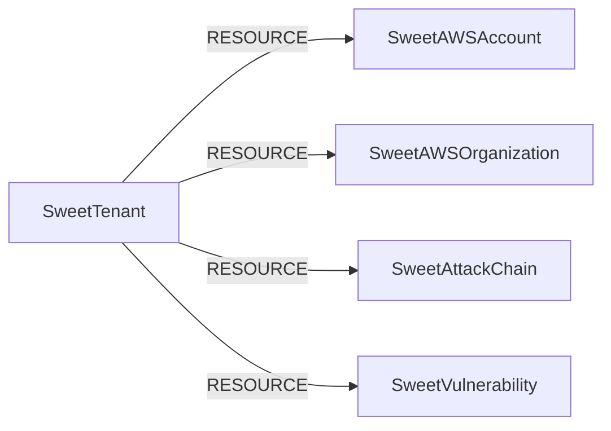

<!-- Generated from the data model. Do not edit manually. -->

## Sweet Security Schema

### SweetAttackChain

An attack chain that Sweet validated against an application's endpoints, excluding resolved and closed chains.

> **Ontology Mapping**: This node uses the ontology label [`SecurityIssue`](#ontology-securityissue).

#### Properties

Ontology-generated fields are shown in *italics*.

| Field | Index | Description |
|-------|-------|-------------|
| id | Yes | Sweet attack chain ID. |
| firstseen |  | Timestamp when a sync job first created this node. |
| lastupdated | Yes | Timestamp when this Sweet attack chain was last synced. |
| asset_id | Yes | Sweet ID of the asset the chain is linked to. Null when the chain has no linked asset. |
| campaign_name |  | Name of the Sweet campaign that produced the chain. |
| confidence | Yes | How far Sweet validated the chain, such as `fully-validated`. Null when unknown. |
| cwe |  | CWE identifiers for the attack chain. |
| description |  | Attack chain description. |
| domain | Yes | Host of the affected endpoints, lowercased and without a trailing dot. |
| endpoints |  | Affected endpoints as `METHOD path` strings. |
| execution_name |  | Name of the Sweet execution the chain was seen in. |
| first_detected_at |  | When Sweet first detected the attack chain. |
| impact |  | Impact tags for the attack chain. |
| last_detected_at |  | When Sweet last detected the attack chain. |
| owasp |  | OWASP categories that the attack chain falls under. |
| severity | Yes | Attack chain severity: `critical`, `high`, `medium`, or `low`. |
| status | Yes | Sweet status: `Open` or `In Progress`. |
| story |  | Markdown narrative of the attack chain, one numbered line per step. |
| title |  | Attack chain title. |
| *_ont_first_seen* | Yes | Normalized field sourced from `first_detected_at`. |
| *_ont_severity* | Yes | Normalized field sourced from `severity`. |
| *_ont_source* |  | Module that populated this node's ontology fields. |
| *_ont_status* | Yes | Normalized field sourced from `status`. |
| *_ont_title* | Yes | Normalized field sourced from `title`. |
| *_ont_type* | Yes | Property generated by the ontology mapping. |

#### Relationships

- `(:SweetAttackChain)-[:AFFECTS]->(:DNSRecord)`: Links a Sweet attack chain to every synced DNS record whose name is the chain's endpoint host.

- `(:SweetTenant)-[:RESOURCE]->(:SweetAttackChain)`: Links a Sweet tenant to one of its attack chains.

### SweetAWSAccount

An AWS account that is connected to Sweet on its own, outside an organization connection.

#### Properties

| Field | Index | Description |
|-------|-------|-------------|
| id | Yes | Sweet tenant ID and AWS account ID joined with `:`. |
| firstseen |  | Timestamp when a sync job first created this node. |
| lastupdated | Yes | Timestamp when this Sweet AWS account connection was last synced. |
| account_id | Yes | AWS account ID that is connected to Sweet. |
| enabled |  | Whether the connection is enabled in Sweet. |
| regions |  | AWS regions that Sweet monitors in the account. |
| role_arn | Yes | ARN of the cross-account IAM role that Sweet assumes in the account. |

#### Relationships

- `(:SweetAWSAccount)-[:MONITORS]->(:AWSAccount)`: Links a Sweet AWS account connection to the AWS account it monitors.

- `(:SweetTenant)-[:RESOURCE]->(:SweetAWSAccount)`: Links a Sweet tenant to an AWS account connection it owns.

### SweetAWSOrganization

An AWS organization that is connected to Sweet through its management account.

#### Properties

| Field | Index | Description |
|-------|-------|-------------|
| id | Yes | Sweet tenant ID and management account ID joined with `:`. |
| firstseen |  | Timestamp when a sync job first created this node. |
| lastupdated | Yes | Timestamp when this Sweet AWS organization connection was last synced. |
| enabled |  | Whether the connection is enabled in Sweet. |
| management_account_id | Yes | AWS account ID of the organization's management account. |
| regions |  | AWS regions that Sweet monitors across the organization. |
| role_arn | Yes | ARN of the cross-account IAM role that Sweet assumes in the management account. |

#### Relationships

- `(:SweetAWSOrganization)-[:MONITORS]->(:AWSAccount)`: Links a Sweet AWS organization connection to the organization's management account.

- `(:SweetTenant)-[:RESOURCE]->(:SweetAWSOrganization)`: Links a Sweet tenant to an AWS organization connection it owns.

### SweetTenant

A Sweet Security tenant, the cleanup scope for every imported Sweet node.

> **Ontology Mapping**: This node uses the ontology label [`Tenant`](#ontology-tenant).

#### Properties

Ontology-generated fields are shown in *italics*.

| Field | Index | Description |
|-------|-------|-------------|
| id | Yes | Operator-supplied identifier for the Sweet tenant. The Sweet API has no endpoint that returns the tenant's own ID. |
| firstseen |  | Timestamp when a sync job first created this node. |
| lastupdated | Yes | Timestamp when this Sweet tenant was last synced. |
| api_url |  | Sweet API origin used for this tenant. |
| *_ont_source* |  | Module that populated this node's ontology fields. |

#### Relationships

- `(:SweetTenant)-[:RESOURCE]->(:SweetAWSAccount)`: Links a Sweet tenant to an AWS account connection it owns.

- `(:SweetTenant)-[:RESOURCE]->(:SweetAWSOrganization)`: Links a Sweet tenant to an AWS organization connection it owns.

- `(:SweetTenant)-[:RESOURCE]->(:SweetAttackChain)`: Links a Sweet tenant to one of its attack chains.

- `(:SweetTenant)-[:RESOURCE]->(:SweetVulnerability)`: Links a Sweet tenant to one of its runtime vulnerabilities.

### SweetVulnerability

A vulnerable package that Sweet found on a running workload, excluding resolved vulnerabilities.

> **Conditional Labels**:
>
> - [`CVE`](#ontology-cve) (ontology label) when `has_cve` equals `true`. A cross-provider CVE resource in Cartography's ontology.

#### Properties

Ontology-generated fields are shown in *italics*.

| Field | Index | Description |
|-------|-------|-------------|
| id | Yes | Sweet vulnerability instance ID. One CVE has a separate instance for each package and image it affects. |
| firstseen |  | Timestamp when a sync job first created this node. |
| lastupdated | Yes | Timestamp when this Sweet vulnerability was last synced. |
| attack_labels |  | Attack context labels from Sweet. |
| cloud_account |  | Name of the cloud account that runs the workload. |
| code_owner_email |  | Email of the code owner Sweet assigns to the vulnerability. |
| code_owner_name |  | Name of the code owner Sweet assigns to the vulnerability. |
| cve_id | Yes | CVE ID, set only when Sweet's identifier is a CVE. |
| epss_percentile |  | EPSS percentile, from 0 to 100. |
| epss_score |  | Exploit Prediction Scoring System (EPSS) probability, from 0 to 1. |
| first_detected |  | When Sweet first detected the vulnerability on the workload. |
| fixed_in_versions |  | Package versions that contain the fix. |
| has_cve |  | Whether the vulnerability has a CVE ID (`true` or `false`). |
| has_fix |  | Whether a fixed package version exists. |
| image_digest | Yes | Digest of the container image that contains the package. |
| image_name |  | Name of the container image that contains the package. |
| image_registry |  | Registry of the container image that contains the package. |
| image_tag |  | Tag of the container image that contains the package. |
| last_detected |  | When Sweet last detected the vulnerability on the workload. |
| last_executed |  | When Sweet last saw the vulnerable package executed at runtime. Null if Sweet hasn't seen it executed. |
| last_loaded |  | When Sweet last saw the vulnerable package loaded into memory at runtime. Null if Sweet hasn't seen it loaded. |
| package_manager |  | Package manager or ecosystem of the vulnerable package. |
| package_name | Yes | Name of the vulnerable package. |
| package_version |  | Installed version of the vulnerable package. |
| published_date |  | Date the vulnerability was published. |
| risk_indicators |  | Runtime risk indicators Sweet observed in the past week. |
| severity | Yes | CVSS base severity reported by Sweet. |
| status | Yes | Sweet status: `open`, `in_progress`, or `ignored`. |
| sweet_score |  | Sweet risk score from 0 to 10, which weighs runtime context. |
| sweet_severity | Yes | Sweet severity derived from the Sweet score. |
| vulnerability_id | Yes | Vulnerability identifier exactly as Sweet reports it, such as a CVE or GHSA ID. |
| workload | Yes | Name of the workload that runs the vulnerable package. |
| *_ont_base_severity* | Yes | Normalized field sourced from `severity`. |
| *_ont_cve_id* | Yes | Normalized field sourced from `cve_id`. |
| *_ont_published_date* | Yes | Normalized field sourced from `published_date`. |
| *_ont_source* |  | Module that populated this node's ontology fields. |
| *_ont_vuln_status* | Yes | Normalized field sourced from `status`. |

#### Relationships

- `(:SweetVulnerability)-[:AFFECTS]->(:Image)`: Links a Sweet vulnerability to every synced copy of the container image it affects, matched on the image digest.

- `(:SweetVulnerability)-[:LINKED_TO]->(:CVE)`: Links a Sweet vulnerability to the CVE it names.

- `(:SweetTenant)-[:RESOURCE]->(:SweetVulnerability)`: Links a Sweet tenant to one of its runtime vulnerabilities.
